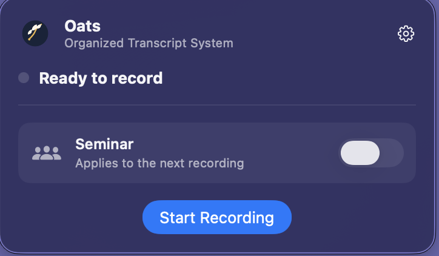
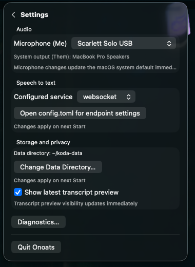

# onoats

**Always-on Organized Audio Transcript System** — [onoats.dev](https://onoats.dev)

onoats is a local-first voice recorder and transcript converter. It captures
your microphone (**me**) and system audio (**them**) as separate streams,
transcribes both, and writes chronological sessions as plain JSONL and Markdown.

There is no database. The converter needs no API keys, and downstream tools can
consume the same filesystem queue without depending on onoats internals.

<table>
  <tr>
    <td width="69%" valign="top">
      
    </td>
    <td width="31%" valign="top">
      
    </td>
  </tr>
  <tr>
    <td align="center"><em>Start a recording and set the Seminar label.</em></td>
    <td align="center"><em>Choose audio, STT, storage, and privacy settings.</em></td>
  </tr>
</table>

## Quickstart

### macOS 14.4+ — menu bar + native capture (recommended)

Install the Xcode Command Line Tools and [uv](https://docs.astral.sh/uv/), then:

~~~bash
git clone https://github.com/vr000m/onoats-bot.git
cd onoats-bot
make -C native setup
~~~

The setup command builds and signs **Onoats.app**, installs it in
`~/Applications`, installs the CLI, and runs the guided configuration. Open
the app and select **Start Recording**. The first run asks for microphone and
system-audio permission.

### macOS 14.4+ — CLI + native capture (no menu bar)

~~~bash
git clone https://github.com/vr000m/onoats-bot.git
cd onoats-bot
make -C native setup-cli
~~~

This installs the CLI and signed native capturer without the app. The command
prints the exact environment needed to start a socket-capture session.

### Other platforms (and macOS below 14.4) — CLI + PortAudio

~~~bash
uv tool install onoats
onoats init
onoats bot
~~~

System-audio capture needs a loopback device on this path. See the
[complete installation guide](https://github.com/vr000m/onoats-bot/blob/main/docs/installation.md)
for prerequisites,
platform support, extras, native CLI usage, and the BlackHole fallback.

## Everyday commands

~~~bash
onoats init         # configure storage, audio, and speech-to-text
onoats bot          # record microphone + system audio
onoats status       # inspect recorder state, devices, and warnings
onoats flush        # rotate the current buffer without stopping
onoats stop         # drain, rotate, and stop the recorder
onoats convert      # render pending JSONL sessions as Markdown
onoats devices      # list PortAudio devices
~~~

`onoats bot-single` remains available for legacy microphone-only recording.

## How it works

1. The recorder keeps microphone and system audio on separate branches.
2. Each branch has its own STT session and produces canonical `me` or `them`
   utterances.
3. A completed or flushed session moves atomically into
   `sessions/pending/`.
4. `onoats convert`, or another queue consumer, claims the JSONL and renders
   the result.

The recorder never reconnects a failed native audio stream itself. Failures are
bounded and loud; each supervisor owns one generation, while partial transcripts
still rotate into the queue. For a menu-bar-owned
`capture-heartbeat-stalled` failure only, the app verifies the exact failed
generation and starts one wholly fresh supervisor generation automatically.
Direct CLI sessions and other failures remain stopped.

## Cross-platform matrix

| Capability | Linux / Windows / Intel Mac | Apple Silicon Mac |
|---|---|---|
| CLI + PortAudio capture | ✅ | ✅ |
| Hosted or local TCP STT | ✅ | ✅ |
| Native system-audio capture | — | ✅ macOS 14.4+ |
| Menu-bar app | — | ✅ macOS 14.4+ |
| Local Whisper-MLX | — | ✅ `[macos]` extra |
| Speaker diarization | — | ✅ opt-in extra |

The baseline install is MLX-free. Native capture uses a Core Audio process tap
and does not need a virtual loopback device.

## Menu bar (macOS)

The menu-bar app puts the common actions first:

- **Start / Stop / Flush** control the current recorder generation.
- **Seminar** locks that category for the next app-owned recording.
- **Settings** manages the microphone, STT service, data directory, transcript
  preview, configuration file, and diagnostics.
- Live, display-only telemetry shows audio activity and STT health without
  becoming an authority for capture or persistence.

The app and CLI read the same `config.toml`. A running session snapshots its
configuration and data directory, so edits apply to the next Start.

See the [menu-bar guide](https://github.com/vr000m/onoats-bot/blob/main/docs/menu-bar.md)
for permissions, status meanings,
privacy controls, logs, warnings, login-item behaviour, and generation-bound
Stop/Flush semantics.

## Configuration

`onoats init` writes `config.toml`, `secrets.env`, and `dictionary.txt`
under `$XDG_CONFIG_HOME/onoats`. Process environment values override config
files, which override built-in defaults.

The [configuration guide](https://github.com/vr000m/onoats-bot/blob/main/docs/configuration.md)
documents every file, STT
backend and endpoint, launchd self-healing, shutdown timing, and storage option.

### Speaker diarization (opt-in)

Diarization labels speakers only on the **them** channel and requires websocket
STT plus the `diarization` extra and locally cached model weights. It fails
open during a session: transcription continues without labels.

See [speaker diarization](https://github.com/vr000m/onoats-bot/blob/main/docs/configuration.md#speaker-diarization-opt-in)
for
installation, model download, label semantics, and limitations.

### Audio source

`socket` is the recommended native macOS path; `portaudio` is the default
cross-platform path. Select one with `AUDIO_SOURCE`, `config.toml`, or
`onoats bot --source`.

See [audio sources](https://github.com/vr000m/onoats-bot/blob/main/docs/configuration.md#audio-source)
and the versioned
[capturer wire contract](https://github.com/vr000m/onoats-bot/blob/main/docs/audio-socket-contract.md).

### Data location

The default data root is `$XDG_DATA_HOME/onoats`
(`~/.local/share/onoats`). Change it with `[storage] data_dir`,
`ONOATS_DATA_DIR`, or `onoats init --data-dir`.

See [data location and queue ownership](https://github.com/vr000m/onoats-bot/blob/main/docs/configuration.md#data-location)
before sharing a queue with another worker.

## The queue contract

Every session is a type-discriminated JSONL file under
`sessions/pending/`. The first line is `session_meta`; later lines are
`utterance` or `silence_gap`. Queue publication uses an atomic rename.

The versioned [queue contract](https://github.com/vr000m/onoats-bot/blob/main/docs/queue-contract.md)
defines fields,
categories, run IDs, diarization metadata, and consumer ownership.

## Documentation

| Guide | Covers |
|---|---|
| [Installation](https://github.com/vr000m/onoats-bot/blob/main/docs/installation.md) | platform choices, prerequisites, extras, and updates |
| [Menu bar](https://github.com/vr000m/onoats-bot/blob/main/docs/menu-bar.md) | controls, permissions, telemetry, privacy, warnings, and logs |
| [Configuration](https://github.com/vr000m/onoats-bot/blob/main/docs/configuration.md) | config files, STT, diarization, audio, storage, and precedence |
| [Queue contract](https://github.com/vr000m/onoats-bot/blob/main/docs/queue-contract.md) | canonical JSONL interface for downstream consumers |
| [Native build and release](https://github.com/vr000m/onoats-bot/blob/main/native/README.md) | signing, staged installation, smoke, rollback, and TCC |
| [Recorder control socket](https://github.com/vr000m/onoats-bot/blob/main/docs/control-socket-contract.md) | generation-authenticated Flush and Stop protocol |
| [Audio socket contract](https://github.com/vr000m/onoats-bot/blob/main/docs/audio-socket-contract.md) | native capturer framing, handshake, and backpressure |
| [BlackHole fallback](https://github.com/vr000m/onoats-bot/blob/main/docs/blackhole-fallback.md) | loopback setup for the PortAudio path |

## License

BSD-2-Clause — see
[LICENSE](https://github.com/vr000m/onoats-bot/blob/main/LICENSE).
