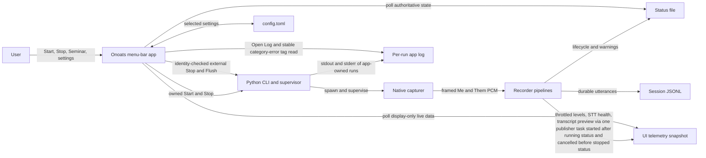
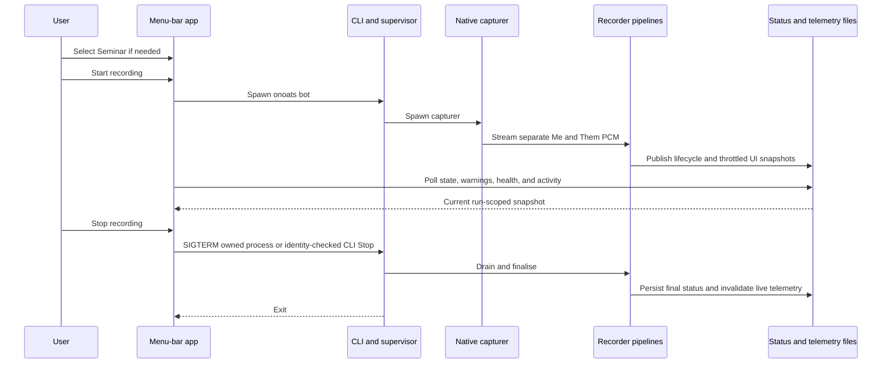

# Task: Onoats Menu-Bar Control Panel and Brand Mark

**Status**: In Progress
**Component**: recorder, stt, macos, packaging
**Assigned to**: Codex
**Priority**: High
**Branch**: feature/menubar-control-panel
**Created**: 2026-10-28
**Review Gates**: full

## Objective

Replace Onoats.app's flat menu with a compact window-style recording panel centred on Start, Stop, and the optional Seminar lock. Add truthful live status, reorganise infrequent controls under an in-panel settings view, and establish a reusable Onoats brand mark plus a monochrome macOS menu-bar icon without changing recorder safety contracts.

## Context

The current SwiftUI `MenuBarExtra` uses the default menu presentation. It places lifecycle controls, Seminar, device selection, STT selection, storage paths, diagnostics, and Quit in one flat list. The product owner confirmed the primary menu-bar workflow is narrower: open the menu-bar item, optionally select Seminar, then Start or Stop. Phase 1 validates the brand direction; The Post-Gauntlet Release Steps validate the final control hierarchy in the signed native smoke.

The recorder already exposes authoritative process liveness, warnings, start time, device names, and a running STT label. It does not expose per-branch activity, structured STT health, or a safe last-transcript preview. Those values must come from the runtime that owns the audio and STT connections; Swift must not infer them from an endpoint probe or stale session file.

This repository contains no website source or existing logo assets. This plan creates canonical brand assets and integrates them into Onoats.app. Applying the brand to onoats.app itself remains a separate repository task once that checkout is identified.

Explore facts in this plan are point-in-time contract facts. A later correction to a verified path, pattern, or dependency invalidates the review marker and requires `/review-plan` again.

## Requirements

- Use `.menuBarExtraStyle(.window)` and a compact fixed-width panel.
- Make Start or Stop the dominant control. Preserve its current lifecycle routing:
  - app-owned Stop terminates the retained supervisor `Process` gracefully;
  - external-session Stop invokes identity-checked `onoats stop`;
  - Flush invokes identity-checked `onoats flush`.
- Show the Seminar control only before Start. Preserve its next-session-only, in-memory, reset-on-exit semantics. During an app-owned locked session, keep that selected lock as the badge authority even if telemetry disappears. During an external session, show the badge only from fresh same-owner telemetry; otherwise show `Category unavailable` rather than assuming Seminar.
- Keep warnings, failure detail, schema drift, external-session state, stopping/draining state, and login-item hints visible and accessible.
- Keep STT operational state visible on the main panel. Put the STT service picker and advanced endpoint access inside the settings view.
- Move microphone selection, data-directory selection, config access, CLI diagnostics, and Quit into an in-panel settings view reached by a gear button.
- Preserve `config.toml` as the shared source of truth for recorder settings. UI-only presentation preferences may use `UserDefaults`.
- Do not add a launch-at-login toggle. `config.toml` remains its only control surface.
- Show Me/Them activity only when both the runtime snapshot and that branch's last audio observation are fresh. Render a branch as a visible greyed `No signal` row after one second without a new observation; never convert missing or stale data into a healthy signal.
- Scope new activity telemetry to the CoreAudio/socket path used by Onoats.app. Preserve PortAudio and `bot-single` as unchanged CLI compatibility paths; an externally started unsupported session shows activity unavailable.
- Present one combined STT row for the menu-bar app's two required branches: `failed` if either fails, `recovering` if either recovers, `starting` if either starts, `unknown` if either branch's backend publishes no state (`whisper`, `deepgram`), and `ready` only when both websocket branches confirm ready. Show branch detail only when the aggregate is not ready. Swift recomputes this aggregate and rejects a snapshot whose published aggregate disagrees.
- Make the last-transcript preview opt-in and off by default. Bound its length and keep the full transcript only in the existing session JSONL.
- Keep the lifecycle status schema at v2. Live display telemetry uses its own versioned, ephemeral contract.
- Telemetry failures must fail open: they may degrade the panel, but must never stop capture, STT, transcript persistence, or shutdown.
- Preserve never-mix, no-PortAudio-on-socket, bounded transport, status/PID ordering, graceful drain, and Swift/Python parity invariants.
- Create two related but distinct visual assets:
  - a full Onoats brand mark/wordmark for the app header and future website use;
  - a monochrome template icon that remains legible at macOS menu-bar sizes.
- Keep canonical vector brand sources in the repository. Commit required native exports and copy them explicitly into the signed app bundle.
- Snapshot the configured data directory synchronously at Start and pin it until that recorder exits. Export it to the supervisor as `ONOATS_DATA_DIR`, use it for status/PID/telemetry reads and exit handling, and pass it explicitly to external Stop and Flush. A changed configured directory applies on the next Start.
- When the configured directory changes mid-session, show both `Recording to: <active>` and `Next recording: <configured>` in the panel until convergence.
- Expose `Open Log` on warning/failure surfaces of app-owned sessions and failed app-owned starts only, and expose both `Open Log` and `Show Logs Folder` under Settings → Diagnostics. The canonical log is the app-captured stdout/stderr file of the most recent app-owned run: one `onoats-bot-<spawnEpoch>.log` per run in the existing Logs folder, newest 10 kept. `<spawnEpoch>` is the Swift app's Start-attempt time in integer epoch milliseconds, taken just before the spawn; it is unrelated to the Python-minted recorder run epoch. `Open Log` opens the in-memory path of the most recent app-owned run of this app process; if that file is gone it reveals the Logs folder. Only when the app holds no in-memory path (fresh launch) does it first scan for the newest `onoats-bot-<spawnEpoch>.log`, still falling back to the folder when none exists. App-owned Flush and Stop output appends to that run's file; external Stop and Flush output is not written to a run log. An external session's warning says `Log not captured (started outside the menu bar)` and offers no `Open Log`. Fall back to the folder when the log file does not exist; do not embed a live log tail.
- Do not change the website in this plan because its source is not present in this checkout.

## Review Focus

- Verify that UI changes preserve identity-checked Stop/Flush, authoritative PID liveness, and draining-state behaviour.
- Verify telemetry ownership, freshness, atomic replacement, bounded update rate, owner-checked cleanup, and fail-open error handling.
- Verify audio-level instrumentation cannot mix Me and Them or bypass transport backpressure.
- Verify STT colours never claim endpoint health from configuration, process existence, or an independent Swift probe.
- Verify transcript-preview privacy, truncation, file permissions, and stale-session rejection.
- Verify native resources remain inside the explicitly signed bundle and do not alter its bundle identifier or designated-requirement strategy.
- Verify every cross-language literal or field has parity coverage and that the lifecycle status schema remains unchanged.
- Verify the native manual smoke matrix covers keyboard access, VoiceOver labels, panel dismissal, and all existing actions.
- Verify the menu-bar scope does not add telemetry requirements to PortAudio or `bot-single`.
- Verify log actions open only the canonical log file/folder and never render log content inside the popover.
- Verify per-branch observation ages cannot be refreshed by a snapshot heartbeat and that aggregate STT drift is rejected.
- Verify active-directory pinning governs process launch, reads, Flush, external Stop, and exit handling.
- Verify the pre-PID permission-wait warning decorates only the matching app-owned starting attempt and never establishes recorder liveness.
- Verify staged smoke and installation exercise the same verified app hash and CLI git revision, with explicit clean-install and rollback-baseline behaviour.

## Implementation Checklist

### Phase 1: Brand Direction and Canonical Assets (manual design gate; not `/conduct`-driven)

**Goal:** Approve one recognisable Onoats mark before native integration. The full brand and the menu-bar glyph must share a visual idea without forcing a detailed colour logo into an 18-point monochrome slot.

- Produce two or three compact directions based on an oat-grain/speech-waveform motif.
- Review each direction at website/header scale and at 16, 18, and 22 point monochrome menu-bar scale.
- Obtain user approval for one direction before creating production exports.
- Create the new `assets/brand` and `native/onoats-menubar/Resources` directories explicitly.
- Add canonical SVG mark and wordmark sources plus documented colour, spacing, and monochrome rules.
- Export the app-header image, one monochrome template menu icon per recorder state (idle, recording, warning, busy, failed) at 1x/2x, and the `.icns` app icon.
- Record export sizes and source-to-export mapping so later website work can reuse the same source.
- Before any Phase 2 code change, record the rollback baseline under `## Findings` below the marker: `git rev-parse HEAD` (with an empty `git status --porcelain`) as the baseline CLI SHA, the current branch name or detached state, the exact `install-cli` command and `EXTRAS`, `command -v onoats`, the installed app's designated requirement, and `make -C native cdhash` of the installed `Onoats.app` (or `none` when no app is installed). The Post-Gauntlet rollback preflight compares against exactly these values. A missing baseline field makes this release a clean-install case with no rollback claim; never reconstruct a missing value after implementation begins.

### Phase 2: Ephemeral UI Telemetry Contract and Runtime Producer

**Impl files:** `src/onoats/ui_telemetry.py, src/onoats/transports/socket_audio.py, src/onoats/dual.py, src/onoats/processors/transcript_buffer.py, src/onoats/runtime.py, src/onoats/stt/websocket_stt_service.py, src/onoats/__main__.py`
**Test files:** `tests/test_ui_telemetry.py, tests/test_socket_audio_transport.py, tests/test_dual_socket_source.py, tests/test_websocket_stt_reconnect.py, tests/test_speaker_labels.py, tests/test_status_file.py, tests/test_socket_supervisor.py, tests/test_stt_config_wiring.py, tests/test_runtime_preflight.py`
**Test command:** `uv run pytest tests/test_ui_telemetry.py tests/test_socket_audio_transport.py tests/test_dual_socket_source.py tests/test_websocket_stt_reconnect.py tests/test_speaker_labels.py tests/test_status_file.py tests/test_socket_supervisor.py tests/test_stt_config_wiring.py tests/test_runtime_preflight.py -q`
**Goal:** Runtime telemetry is display-only, branch-safe, stale-rejectable, bounded, and incapable of affecting recorder success or transcript durability.

- Add a separate schema-v1 `.active/onoats.ui.json` snapshot. Do not add fields to `StatusRecord` or bump `STATUS_SCHEMA_VERSION`.
- Define one exact record shape shared by Python tests and Swift decoding: schema, recorder PID/start epoch, update time, optional Me/Them levels with per-branch observation timestamps, per-branch plus aggregate STT state/detail, optional bounded transcript preview/source/speaker label, and locked category.
- Write snapshots by same-directory temporary file plus `os.replace`, with owner-only permissions. Because the file is ephemeral, do not `fsync` every meter update.
- Define Python-owned constants (the Swift mirror and the telemetry parity tests land together in Phase 4's first commit, so no commit holds a parity test without its Swift target; the stable category-error tag lands in Phase 3 and its Swift pin lands with the matcher in Phase 6): schema `1`, file name `onoats.ui.json`, mode `0o600`, maximum write rate `4 Hz`, unchanged-state heartbeat `2 s`, snapshot expiry `5 s`, per-branch audio-observation expiry `1 s`, per-branch observation refresh `500 ms` while frames continue, the Seminar category literal `seminars`, transcript limit `240` Unicode code points, detail limit `256` Unicode code points, and level range `[0.0, 1.0]`. Every telemetry timestamp (snapshot time, per-branch observation times, run epoch) is wall-clock epoch seconds from `time.time()`, matching `status.py`; no monotonic clock crosses the file boundary.
- Let audio/STT/transcript callbacks update memory only. Coalesce changed snapshots and heartbeats through one bounded background task; no callback performs filesystem I/O or awaits persistence.
- Suppress redundant intermediate snapshots, but write an unchanged heartbeat every 2 seconds so healthy telemetry never expires. A heartbeat updates only snapshot time; it never advances either branch's audio-observation timestamp. An advancing branch observation timestamp counts as a changed snapshot: a branch with continuing frames publishes an observation-time refresh at least every 500 ms, inside the 4 Hz cap.
- Reject non-finite or out-of-range level values at the publisher boundary: drop that observation and keep the last good value. A rejected observation advances neither the level nor that branch's observation time, so a branch emitting only rejected values for more than 1 s renders `No signal`. There is no clamping. Boundary verdicts: `-0.0` accepted and published as `0.0`, `0.0` and `1.0` accepted, `1.0000001`, `inf`, and `nan` rejected. The snapshot writer uses `json.dumps(..., allow_nan=False)`, so a non-finite value can never reach the file. JSON cannot encode `inf` or `nan`, so the verdict table in `tests/fixtures/ui_telemetry/` stores level inputs as strings (`"-0.0"`, `"inf"`, `"nan"`); the Python tests and the Swift harness both read it and parse each with their own float parser.
- Construct telemetry only for `audio_source == "socket"`. Inject source-labelled level observers into the two existing socket transports through one named hook, `on_level: Callable[[float], None] | None = None` (keyword-only), added to the `UnixSocketAudioTransport` facade and its inner input transport. `_build_socket_transports(cfg, *, on_mic_level=None, on_system_level=None)` hands each branch its own callable, which closes over that branch's source. Keep the transport generic and preserve one socket to one branch. PortAudio and `bot-single` remain unchanged. Compute each frame's peak from the validated PCM16 bytes with `array('h')` max-abs divided by 32768 (`audioop` is removed in Python 3.13 and the project allows `>=3.12`; no new dependency). Wrap the observer so an exception is caught, logged once and rate-limited, and never raised into the reader.
- Publish transcript preview data from final `TranscriptionFrame` handling without changing JSONL entries or render-time speaker composition.
- Track mic and system STT state independently. Aggregate by fixed precedence `failed > recovering > starting > unknown > ready`; `ready` requires both branches ready. Use `unknown` for backends without a trustworthy confirmation hook. Treat branch states as the aggregate's source of truth. Per-state definitions live once in the UI Telemetry Contract. Runtime sets `starting` at construction for websocket instances only; a non-websocket instance is set to `unknown` at construction and never changes, so `starting` cannot outrank it forever. `WebSocketSTTService` gains keyword-only `on_ready()`, `on_recovering()`, and `on_failed(detail)` callbacks. They enter through new keyword-only `on_ready`, `on_recovering`, and `on_failed` parameters on `_create_stt_service` (beside `data_dir`, `branch_instance`, and `stamp_segment_samples`); the internally built `on_recovery` is not a factory parameter and is untouched. `on_recovering` also fires when `_read_events`' teardown detects a lost established connection (not on a deliberate `stop()`/`cancel()` close), because that path only clears `_connected` and relies on a demand-driven reconnect. Reconnect semantics do not change.
- Sanitize STT detail through existing URI/exception redaction before it reaches telemetry. Redaction happens in the caller (`runtime.py` or the STT service); `ui_telemetry.py` receives already-redacted text and only caps its length.
- Mint one run epoch (`time.time()`, via one `runtime.py` helper) before PID/status publication. `_write_pid_file` takes a required caller-minted `start_epoch` instead of reading the clock itself (no optional default, so no second clock read survives), `_write_status_running` forwards it as `start_time` (`status.write_running` already accepts it, so `status.py` needs no change), and both return success so `dual.py` can gate telemetry. `_write_pid_file` has three call sites: `dual.py` (two sites) and `run_onoats` (`bot-single`) in `src/onoats/__main__.py`; each mints and passes its epoch explicitly, and `bot-single` still builds no telemetry. Build the in-memory telemetry state holder before transports and STT services so their callbacks have a target, but enable file writes only after PID then running-status publication succeeds.
- Create the one publisher task in `dual.py` right after `_write_status_running` succeeds. In `_run_shutdown`, cancel and join it (bounded) before calling the module-level sync helper `_finalize_shutdown_status`. Give that helper an optional keyword-only `telemetry_cleanup` callable it runs between `_write_status_stopped` and `_remove_pid_file`; the default `None` keeps today's behaviour. Never let the cancel/join delay `force_exit_event` or `wait_or_force`.
- Make producer and cleanup errors warning-only. Cleanup may unlink only a snapshot that still belongs to the same PID/start epoch.
- Rate-limit repeated write/cleanup warnings, log one recovery after writes resume, and test both with a fake clock.
- Invalidate or remove live telemetry after the recorder writes its stopped status; a leftover file remains harmless because consumers reject stale ownership/freshness.
- Keep `ui_telemetry.py` a leaf module: stdlib only, no `onoats` imports. `socket_audio.py`, `TranscriptBuffer`, and `WebSocketSTTService` receive plain callables, never the module.
- Add pinning tests: a raising level observer does not disturb the socket reader or staging; `audio_source == "portaudio"` builds no publisher and `run_onoats` (`bot-single`) never constructs one; no telemetry file exists before `_write_status_running` returns and a raising `write_running` leaves none; PID line 4, status `start_time`, and the telemetry epoch are identical; `run_onoats` passes its own minted epoch to `_write_pid_file`; `_finalize_shutdown_status` runs `telemetry_cleanup` after the stopped status and before pid removal and is unchanged when it is `None` (extend the direct-call ordering test in `tests/test_socket_supervisor.py`); `_create_stt_service` forwards `on_ready`/`on_recovering`/`on_failed` (`tests/test_stt_config_wiring.py`); a lost established connection fires `on_recovering` once; a non-websocket instance is `unknown` from construction.

### Phase 3: Accepted Review Remediation for Completed Runtime Work

**Impl files:** `src/onoats/__main__.py, src/onoats/categories.py, src/onoats/dual.py`
**Test files:** `tests/test_categories.py, tests/test_cli.py, tests/test_socket_supervisor.py`
**Test command:** `uv run pytest tests/test_categories.py tests/test_cli.py tests/test_socket_supervisor.py -q`
**Validation cmd:** `uv run ruff check src/onoats/__main__.py src/onoats/categories.py src/onoats/dual.py tests/test_categories.py tests/test_cli.py tests/test_socket_supervisor.py`
**Goal:** Accepted review findings that cross the completed Phase 2 boundary land in a new committed phase; Phase 2's commit and evidence remain immutable.

- Define one stable machine tag, `ONOATS-ERROR invalid-category`, beside `InvalidCategoryError`. On an invalid category, the CLI writes the exact tag and the existing human-readable explanation to stderr before returning non-zero. The tag is the machine interface; prose remains display-only.
- Pin the tag at its Python producer and error type. Phase 6 adds the Swift matcher and cross-language parity assertion in the same commit as the matcher.
- Add an async shutdown regression whose telemetry publisher resists cancellation or exceeds the normal join bound. Assert shutdown remains bounded, a set `force_exit_event` keeps the zero-timeout path responsive, and stopped-status → telemetry cleanup → pid removal ordering remains intact.
- If the regression fails, repair only the bounded publisher-stop seam. Telemetry remains display-only and cannot delay durable shutdown.

### Phase 4: Swift Telemetry Consumer

**Impl files:** `native/onoats-menubar/Sources/UiTelemetry.swift, native/onoats-menubar/Sources/RecorderModel.swift`
**Test files:** `native/onoats-menubar/Tests/UiTelemetryDecoderHarness.swift, native/onoats-menubar/Tests/RecorderModelHarness.swift, native/test_ui_telemetry.sh, native/test_recorder_model.sh, tests/fixtures/ui_telemetry/, tests/test_native_contract_parity.py`
**Test command:** `native/test_ui_telemetry.sh && native/test_recorder_model.sh && uv run pytest tests/test_native_contract_parity.py -q`
**Validation cmd:** `make -C native build`

**Goal:** The menu app accepts only fresh telemetry for the same live recorder and degrades to neutral UI without changing recorder liveness.

- Add a Swift mirror of the UI telemetry schema without modifying the existing `StatusRecord` mirror.
- Resolve and snapshot the configured directory synchronously before an app-owned Start. Export it as `ONOATS_DATA_DIR`, retain it until that PID/start epoch exits, read status/PID/telemetry and exit status only from it, and pass `--data-dir <active>` to external Stop and Flush. For an externally discovered session, pin the directory that supplied the verified identity.
- Retain the changed configured directory as `nextDataDir` and publish active/next display values when they differ.
- Accept telemetry only when schema, PID, start epoch, snapshot freshness, numeric ranges, and optional-string bounds pass validation. Recompute aggregate STT state from the two branches and reject any mismatch with the published aggregate. Judge per-branch observation age (1 s) per branch after acceptance, so one stale branch renders `No signal` without dropping the other branch or STT state.
- Keep PID identity/liveness authoritative. Telemetry must never create `.running`, `.stopped`, or `.failed` state.
- Clear activity, STT health, telemetry-derived category, and preview when telemetry is missing, stale, malformed, or owned by another run. Preserve the app-owned in-memory Seminar lock as its badge authority; for an external session without trustworthy category telemetry, show `Category unavailable`.
- While the retained app-owned supervisor is alive but no recorder PID exists, accept `write_prestart_waiting` detail only when its status PID matches the retained `ProcessHandle` pid at runtime and its start time is no older than that Start attempt. It may decorate `.starting` but must never create `.running` or override PID liveness; clear it on supervisor exit or authoritative recorder publication. Do not assume a generated shim preserves pid: a forking `cliPath` wrapper fails the runtime match and gets no decoration, by design.
- Poll live telemetry at 4 Hz and animate between samples; keep status/PID polling at its existing cadence.
- Persist only the transcript-preview visibility preference in `UserDefaults`, defaulting to off.
- Add source-reading parity tests for the telemetry schema, allowed STT states, aggregate precedence, bounds, freshness constants, and file name. Pin the Seminar literal `seminars` across Swift `seminarCategory`, the `--category` argv, and the telemetry `category` field. Pin the `ONOATS_DATA_DIR` environment name and the `--data-dir` flag literals the Swift model uses against `_vendor/store.py` and the `onoats stop`/`onoats flush` argparse definitions. Add a source-reading assertion that the new Swift files contain no `URLSession` or `NWConnection` use, which enforces the no-Swift-network-probe rule. The Swift stable category-error tag pin lands in Phase 6 with its Swift constant.
- Create `native/onoats-menubar/Tests/` (it does not exist today) and add a small native decoder harness with shared JSON fixtures. Every fixture carries a `now` field (or offsets relative to it) that both the Python tests and the harness inject, so freshness cases cannot rot. Execute valid, malformed, stale, foreign-owner, boundary, non-finite, aggregate-mismatch, and non-ASCII 239/240/241-scalar cases instead of relying only on source-reading tests. Non-finite snapshots are raw text carrying `NaN`/`Infinity` tokens (not valid JSON), which the strict decoder must reject; boundary level inputs are the string-encoded verdict table. A 256/257-scalar STT detail case pins the detail cap; Swift performs no redaction.
- Introduce a `ProcessHandle` protocol for pid, liveness, termination, exit status, and exit callbacks. `SystemOps` owns process spawn, `kill`, file read/write/delete, and clock operations; its spawn method returns `ProcessHandle`. Inject `SystemOps` through `RecorderModel.init` with a production default, retain protocol handles instead of concrete `Process` values, and route the existing owned Start/Stop/Flush, `kill()`, `FileManager`, and `Timer` call sites through it. Add a native `RecorderModel` harness over that seam; `native/test_recorder_model.sh` compiles `Sources/*.swift` without the `@main` file `OnoatsMenuBarApp.swift`, moving any symbol the model needs out of that file. Exercise directory changes, PID reuse, old-run exit, next-run adoption, owned termination, external `onoats stop --data-dir`, `onoats flush --data-dir`, pre-PID permission detail with PID mismatch, older start time, equality boundary, supervisor exit, authoritative recorder publication, and drain-state convergence. Each pre-PID case asserts that detail clearing never changes recorder liveness.
- Compile with `make -C native build/Onoats` after each model change.

### Phase 5: Native Resource Pipeline and Stateful Menu Icon

**Impl files:** `native/Makefile, native/onoats-menubar/Info.plist, native/onoats-menubar/Sources/OnoatsMenuBarApp.swift, native/onoats-menubar/Resources/`
**Test files:** `tests/test_release_meta.py, tests/test_native_contract_parity.py`
**Test command:** `uv run pytest tests/test_release_meta.py tests/test_native_contract_parity.py -q`
**Validation cmd:** `make -C native sign`

**Goal:** The brand assets are copied and signed predictably, while the menu icon remains a valid macOS template image with distinct recorder states.

- Recreate the staging `Onoats.app` bundle before assembly so stale resources cannot survive an earlier build.
- Extend `native/Makefile` to create `Contents/Resources` and copy each named resource explicitly before signing.
- Verify the staged Resources directory against an explicit allowlist and fail on missing or unexpected entries. Exercise the failure branch once in this phase: plant an extra file, remove an expected one, confirm the verifier fails each time, and record the result.
- Add `CFBundleIconFile` without changing `CFBundleIdentifier`, executable names, deployment floor, or TCC usage strings.
- Load each state's menu glyph as a template image. Template rendering discards colour, so express idle, recording, warning, busy (starting/stopping), and failed as separate pre-rendered monochrome variants selected by state, legible in light and dark menu bars. Do not rely on runtime colour overlays.
- Use the full brand mark only in the panel header and app icon, never as a detailed colour menu-bar image.
- Add release-metadata/source-reading assertions for resource names, bundle-copy steps, template handling, and Info.plist icon metadata.
- Verify the assembled bundle contains every resource before codesigning and that `codesign --verify --deep --strict` succeeds after signing. This Phase 5 signing is a throwaway verification sign: the Post-Gauntlet Release Steps re-assemble and re-sign from post-gauntlet bytes, and only that bundle is smoked or installed.
- If an installed app exists, validate its signature and designated requirement before treating it as a comparison or rollback baseline. A missing or invalid baseline does not block a clean install after staged verification and must never be used for rollback.
- Add two targets to `native/Makefile` here, so the review gauntlet covers them, and assert their presence and semantics in `tests/test_release_meta.py`. `install-staged` has no `sign` or `build` prerequisite: it archives the currently installed app with `ditto -c -k --keepParent` to `~/Library/Application Support/Onoats/app-backups/Onoats-<timestamp>.zip`, never a second launchable `.app` that would share the bundle identifier and could be picked by LaunchServices or `SMAppService.mainApp`. Before deleting the installed app, it records the exact archive path and hash, extracts that archive into a temporary directory, and verifies its signature, designated requirement, and baseline cdhash. Only then may it remove the installed `Onoats.app` and copy the staged app. Remove before copy: `ditto` merges into an existing destination, so a stale file from the old bundle could survive and the post-copy tree digest would differ. `rollback` accepts only that exact preflight-approved archive, removes the installed app, unpacks with `ditto -x -k`, and re-verifies signature, designated requirement, and cdhash. `tests/test_release_meta.py` asserts verify-before-remove and archive identity, plus the remove-then-copy and remove-then-unpack ordering. `install` and `setup` stay unchanged.

### Phase 6: Window-Style Recording Panel and In-Panel Settings

**Impl files:** `native/onoats-menubar/Sources/OnoatsMenuBarApp.swift, native/onoats-menubar/Sources/RecordingPanelView.swift, native/onoats-menubar/Sources/SettingsPanelView.swift, native/onoats-menubar/Sources/RecorderModel.swift, native/onoats-menubar/Sources/ConfigStore.swift`
**Test files:** `native/onoats-menubar/Tests/RecorderModelHarness.swift, native/test_recorder_model.sh, tests/test_native_contract_parity.py, tests/test_release_meta.py`
**Test command:** `native/test_recorder_model.sh && uv run pytest tests/test_native_contract_parity.py tests/test_release_meta.py -q`
**Validation cmd:** `make -C native build`

**Goal:** Opening the menu-bar item makes Start, Stop, and Seminar immediately obvious while preserving every existing action and warning surface.

- Apply `.menuBarExtraStyle(.window)` and replace the flat `MenuContent` with a fixed-width main panel plus an in-panel settings destination.
- Main stopped/failed state: brand header, concise readiness/failure state, warning banners, Seminar toggle, and a full-width Start button.
- Main running state: elapsed time, read-only Seminar badge from the app-owned lock or fresh same-owner external telemetry, Me/Them CoreAudio activity rows, one aggregated STT state with unhealthy branch detail, optional one-line transcript preview, full-width Stop, and secondary Flush. Show `Category unavailable` for an external session whose category cannot be established.
- If active and configured data directories differ, show `Recording to: <active>` and `Next recording: <configured>` until the active recorder exits.
- Keep Start disabled when the CLI is unavailable. Keep Stop disabled only for the existing in-flight external-stop guard.
- Preserve the distinction between app-owned and external sessions, including the “started outside the menu bar” disclosure. Unsupported external capture paths show activity unavailable without gaining new telemetry requirements.
- Keep pre-PID permission-wait detail visible in the matching app-owned starting state without treating it as recorder liveness.
- Route external Stop and Flush through the pinned active directory with explicit `--data-dir`; never let a next-session directory setting retarget the active recorder.
- Settings: microphone picker, system-output display, STT service picker, Open `config.toml`, data-directory picker, transcript-preview toggle, and Quit/Stop & Quit.
- Settings → Diagnostics: Open Log, Show Logs Folder, CLI path/status, active data directory, and next-recording directory. `Open Log` follows the single rule in Requirements: the in-memory path of this process's most recent app-owned run (labelled with its start time); the folder when that file is gone; and, only after an app relaunch with no in-memory path, the newest surviving `onoats-bot-<spawnEpoch>.log`, else the folder.
- Warning and failure surfaces of app-owned sessions and failed app-owned starts include an `Open Log` action. An external session's warning says `Log not captured (started outside the menu bar)` and offers no `Open Log`. Do not tail or render log contents inside the popover.
- Change `RecorderModel` to write one `onoats-bot-<spawnEpoch>.log` per app-owned run, replacing the single appended `onoats-bot.log`. Keep the newest 10 and route app-owned Flush and Stop output into the active run's file. External Stop and Flush output is not written to a run log; their failures surface through the existing warning and failure surfaces. Cover per-run file naming, newest-10 pruning (the 11th run removes only the oldest log and nothing else in the folder), and the Open Log resolution rule in the Phase 4 model harness.
- When an app-owned Start fails with the CLI's stable `ONOATS-ERROR invalid-category` tag, the failure surface says "Seminar needs 'seminars' in config.toml [categories]" and offers `Open Config` next to `Open Log`. The CLI stays the only authority on whether the category is configured; Swift adds no TOML parser. Swift detects only the stable tag through a bounded read of the tail of the run log it just wrote, only on a non-zero exit when no recorder PID was ever published. Human-facing error prose is never a machine interface. Extend `native/test_recorder_model.sh` (`RecorderModelHarness.swift`) with a log-tail fixture: a match only on a non-zero exit with no recorder PID ever published, and no match on a zero exit, a published PID, a missing tag, prose without the tag, or a tag outside the bounded tail. Add the Swift tag constant here and, in the same commit, pin it to the Python constant in `tests/test_native_contract_parity.py`.
- Render a stale Me/Them branch as a visible greyed `No signal` row so panel height stays stable.
- The main panel shows the existing Python-produced, redacted running `sttLabel`. While stopped, settings show only the configured service; advanced endpoint editing and resolution remain config/runtime work.
- Treat advanced STT endpoint editing as config-file work in this release; do not add a partial editor that can leave `ws_socket`, `ws_uri`, `ws_host`, and `ws_port` in conflict.
- Keep “changes apply on next Start” next to controls that write recorder configuration.
- Exercise a missing or unresolvable CLI through the `SystemOps` harness and the stopped-state smoke. Start stays disabled, while Settings → Diagnostics explains the missing CLI.
- Implement the macOS 14.4 interaction fallbacks in this phase: Escape dismissal (`.onExitCommand` or a key monitor), deterministic Tab/Shift-Tab traversal (explicit `.focused` ordering when needed), Space/Return activation (`.keyboardShortcut(.defaultAction)`), and per-state template images in the `MenuBarExtra` label. Conduct verifies the compile/source contracts; the Post-Gauntlet Manual Native Smoke Matrix is the authority for actual panel, keyboard, VoiceOver, and visual behaviour. Record that smoke result under `## Findings` below the marker. If a behaviour is unsupported even with the listed fallback, re-open the plan through `/review-plan` before narrowing the Accessibility smoke wording or the Acceptance Criteria; do not edit contract text silently.
- Give every icon-only control an accessibility label and tooltip. Define a deterministic focus order and keyboard activation for Start/Stop, Seminar, settings/back, and Flush.
- Render long warnings in a bounded, wrapping region without changing the delimiter grammar pinned by Python tests.

### Phase 7: Documentation, Historic Decision Corrections, and Pre-Gauntlet Verification

**Impl files:** `README.md, native/README.md, AGENTS.md, docs/dev_plans/20260609-feature-milestone-b-macos-capture-menubar.md, docs/dev_plans/20260925-feature-menubar-seminar-toggle.md`
**Test files:** `tests/test_native_contract_parity.py, tests/test_status_file.py, tests/test_release_meta.py`
**Test command:** `uv run pytest tests/test_native_contract_parity.py tests/test_status_file.py tests/test_release_meta.py -q`
**Validation cmd:** `python3 scripts/check_review_markers.py && make -C native build`
**Goal:** Documentation describes the final control hierarchy and telemetry contract without rewriting historical implementation logs or weakening reviewed-plan markers.

- Update README/native documentation for the window panel, common Start/Stop/Seminar flow, settings/diagnostics location, telemetry meanings, privacy default, active/next directory disclosure, log actions, and logo asset ownership.
- Grep `docs/dev_plans/` for menu-bar, Seminar, status, telemetry, and branding references.
- Append concise dated corrections to historic plans whose recorded UI decisions are materially superseded, never beside the superseded decision above it. The 20260609 plan keeps its marker below `## Final Results` and above its existing `## Findings`: append under that `## Findings`, below the marker. The 20260925 plan has no review marker and no `## Findings` section: append a new dated `## Findings` section at its end. Neither edit changes a marker hash, and `scripts/check_review_markers.py` must still pass.
- Register `ui_telemetry.py` in AGENTS.md's Leaf modules list and note the telemetry invariants (display-only, fail-open, one publisher task, levels rejected not clamped).
- Run `uv run ruff format` and `uv run ruff check` before the full suite.
- Run `uv run pytest` in full.
- Run `python3 scripts/check_review_markers.py`.
- Build the unsigned compile-smoke binaries with `make -C native build`.
- Before any commit, inspect only explicitly staged paths for secrets, credentials, private transcripts, PII, and unintended binary metadata.
- This phase ends before any signing. `Review Gates: full` then auto-chains the review gauntlet once over the finished branch. The Post-Gauntlet Release Steps start only after the gauntlet converges, so no accepted fix can land after the post-gauntlet bytes have been signed, smoked, or installed (the Phase 5 sign is a throwaway verification sign and does not count).
- Operator workflow: Phase 1 is the completed human design gate, and Phase 2 is the immutable completed runtime phase. `/conduct --resume` walks Phases 3 through 7 in document order, skipping the already checked Phases 1 and 2; each remaining phase has explicit implementation files, test files, a canonical test command, a validation command, and a goal. Phase 3 carries accepted review remediation that crosses the completed-phase boundary. Conduct owns implementation and automated verification for Phases 3–7. The gauntlet fires after Phase 7, the last parsed phase. Signing, interaction/accessibility smoke, exact-byte installation, and rollback validation remain exclusively in the unnumbered Post-Gauntlet Release Steps.

### Post-Gauntlet Release Steps (manual; not a `/conduct` phase)

**Goal:** The bytes that pass smoke are exactly the bytes that are installed, and they are the post-gauntlet bytes. A failed install can only roll back to a verified prior baseline. These steps change no code; any fix goes back through Phase 7 and the gauntlet, then re-smokes.

- After the gauntlet converges, rerun Phase 7's documentation and historic-decision audit against the final diff, then run Ruff format/check, review-marker validation, the full pytest suite, and `make -C native build` on the post-gauntlet tree before signing. Run focused tests for every file the gauntlet touched. If the documentation audit changes any file, rerun the marker check and gauntlet; repeat until both code and documentation reach a fixed point.
- Assemble and sign a staged `Onoats.app`. Verify the resource allowlist, signature, designated requirement, and the app tree digest: sha256 over the sorted per-file sha256 list of the bundle, plus `make -C native cdhash`. Record the CLI identity: `git rev-parse HEAD` with an empty `git status --porcelain`, plus `command -v onoats`. Resolve the shim interpreter and installed distribution metadata, then run an import probe and require `Path(onoats.__file__).resolve()` to belong to this checkout before accepting the CLI identity. Before staged smoke, snapshot `config.toml` bytes and every touched Onoats `UserDefaults` key, including `cliPath` and transcript-preview visibility, and use a dedicated temporary smoke data directory. Restore and byte/value-verify all settings in a finally-style cleanup before `install-staged` and again after post-install smoke.
- Hash and byte-copy claims apply to `Onoats.app` only. The CLI is `uv tool install --editable` of the working tree and has no hashable bytes of its own. Any commit or edit between staged smoke and install forces a re-smoke.
- Preflight any installed app and CLI before treating them as a rollback baseline: require every Phase 1 field, a valid app signature, the expected designated requirement, an installed-app cdhash equal to the recorded baseline, and a prior CLI SHA that still resolves (`git cat-file -e <sha>`). There is no version-string check: the version is 1.5.1 on both sides and the CLI has no `--version` flag. This run's Phase 1 record lacks the exact prior `EXTRAS` and branch/detached state, so it is explicitly a clean-install case and must not claim or attempt rollback. Future runs may use rollback only when every field was recorded before implementation.
- Install the exact staged app bytes that passed smoke using `make -C native install-staged STAGED_APP_TREE_HASH=<pre-smoke-tree-sha256>`, and verify the post-copy app tree digest. If post-install smoke fails, run `rollback` for the app, then `git switch --detach <recorded prior SHA>` and `make -C native install-cli` with the same EXTRAS, but only when the baseline passed preflight. Because the editable CLI is the working tree, rollback leaves it detached at the prior SHA by design: report this and print `git switch <recorded branch>`, and do not switch back automatically. For a clean install, report the failure and do not claim rollback.
- Run the post-install smoke only after the staged bundle passes. Installation is not the first acceptance test.

## Technical Specifications

### Files to Modify

- `native/onoats-menubar/Sources/OnoatsMenuBarApp.swift` — window-style scene, main-panel state, stateful template icon.
- `native/onoats-menubar/Sources/RecorderModel.swift` — `ProcessHandle` plus `SystemOps` seams, telemetry state, authoritative active/next directories for launch/read/signal/exit, pre-PID warning detail, per-run log files and log/folder actions, stable-tag category-error detection, validated refresh integration, retained lifecycle actions.
- `native/onoats-menubar/Sources/ConfigStore.swift` — only if settings navigation needs an existing-key read/write helper; do not broaden it into a full TOML parser.
- `native/onoats-menubar/Info.plist` — app icon metadata only.
- `native/Makefile` — explicit resource assembly and verification inputs (Phase 5), plus new `install-staged` (no `sign`/`build` prerequisite; creates and verifies an exact rollback archive before removing the installed app) and `rollback` targets (Phase 5). `install` and `setup` stay unchanged.
- `src/onoats/transports/socket_audio.py` — optional keyword-only `on_level` callback on the `UnixSocketAudioTransport` facade and its inner input transport, called after frame validation.
- `src/onoats/dual.py` — telemetry state holder, publisher task created after running status and cancelled before stopped status, branch wiring through `_build_socket_transports(cfg, *, on_mic_level, on_system_level)`, STT state wiring, and owner-checked cleanup through a new keyword-only `telemetry_cleanup` callable on `_finalize_shutdown_status`.
- `src/onoats/processors/transcript_buffer.py` — optional finalized-utterance observation hook.
- `src/onoats/runtime.py` — backend-neutral STT state publication around service creation/preflight, and the one caller-minted run epoch: one epoch helper, `_write_pid_file` takes a required `start_epoch`, `_write_status_running` forwards `start_time`, both return success; new keyword-only `on_ready`/`on_recovering`/`on_failed` parameters on `_create_stt_service`.
- `src/onoats/__main__.py` — `run_onoats` (`bot-single`) mints its own epoch and passes it to `_write_pid_file`; it builds no telemetry.
- `src/onoats/stt/websocket_stt_service.py` — keyword-only `on_ready`, `on_recovering`, and `on_failed` callbacks without changing reconnect semantics.
- `tests/test_socket_audio_transport.py` — callback isolation, branch identity, invalid PCM and backpressure regression coverage.
- `tests/test_dual_socket_source.py` — Me/Them telemetry routing without audio mixing; PortAudio and `bot-single` build no publisher.
- `tests/test_websocket_stt_reconnect.py` — confirmed health, recovery, failure, lost-connection `on_recovering`, and redaction transitions.
- `tests/test_stt_config_wiring.py` — `_create_stt_service` forwards the new `on_ready`/`on_recovering`/`on_failed` keywords and sets the initial state per backend.
- `tests/test_runtime_preflight.py` — preflight and recovery paths behave as before with the new callbacks absent, and a redacted detail reaches the failure callback.
- `tests/test_speaker_labels.py` — transcript preview source/speaker rendering parity where applicable.
- `tests/test_native_contract_parity.py` — separate telemetry-schema and Swift-decoder parity, including the Seminar literal `seminars` across Swift `seminarCategory`, the `--category` argv, and the telemetry `category` field, the Swift `ONOATS-ERROR invalid-category` matcher against the Python constant (landing with its Swift constant in Phase 6), the `ONOATS_DATA_DIR` and `--data-dir` literals, and a ban on `URLSession`/`NWConnection` in the new Swift files.
- `tests/test_status_file.py` — lifecycle status remains v2 and warning rendering remains intact.
- `tests/test_socket_supervisor.py` — shared run epoch, identity publication order, `_finalize_shutdown_status` `telemetry_cleanup` ordering, and paired status/PID evidence.
- `tests/test_release_meta.py` — resource, Info.plist, and `install-staged`/`rollback` Makefile contract, including remove-before-copy ordering.
- `README.md`, `native/README.md` — user and maintainer documentation.
- `AGENTS.md` — Leaf modules entry for `ui_telemetry.py` and the telemetry invariants.
- `docs/dev_plans/20260609-feature-milestone-b-macos-capture-menubar.md` — dated correction under its existing `## Findings` (below its marker), only if its menu-presentation decision is stale.
- `docs/dev_plans/20260925-feature-menubar-seminar-toggle.md` — a new dated `## Findings` section appended at its end (the plan has no marker and no existing `## Findings`), preserving Seminar semantics while relocating the control.

### New Files to Create

- `src/onoats/ui_telemetry.py` — stdlib-only leaf module: ephemeral schema, bounded publisher, atomic writer, tolerant reader, and owner-checked cleanup.
- `tests/test_ui_telemetry.py` — contract, freshness, throttling, ownership, atomicity, permissions, failure, and cleanup tests.
- `native/onoats-menubar/Sources/UiTelemetry.swift` — strict Swift decoding and freshness/ownership validation.
- `native/onoats-menubar/Sources/RecordingPanelView.swift` — main recording-control panel.
- `native/onoats-menubar/Sources/SettingsPanelView.swift` — in-panel settings destination.
- `native/onoats-menubar/Tests/UiTelemetryDecoderHarness.swift` — executable strict-decoder harness for shared JSON fixtures.
- `native/onoats-menubar/Tests/RecorderModelHarness.swift` — executable model harness for directory authority, lifecycle routing, and pre-PID warning detail.
- `tests/fixtures/ui_telemetry/` — shared valid, malformed, stale, foreign-owner, boundary, and non-finite vectors, each snapshot with a `now` field (non-finite snapshots are raw text carrying `NaN`/`Infinity` tokens), plus the boundary verdict table with string-encoded level inputs.
- `native/test_ui_telemetry.sh` — compile and run the decoder harness on macOS without introducing Swift Package Manager.
- `native/test_recorder_model.sh` — compile and run the model harness on macOS without introducing Swift Package Manager.
- `assets/brand/onoats-mark.svg` — canonical standalone mark.
- `assets/brand/onoats-wordmark.svg` — canonical mark plus wordmark.
- `assets/brand/README.md` — palette, clear space, small-size, export, and template-icon rules.
- `native/onoats-menubar/Resources/OnoatsHeader.png` and `OnoatsHeader@2x.png` — panel header exports.
- `native/onoats-menubar/Resources/OnoatsMenuBarTemplate<State>.png` and `@2x` for Idle, Recording, Warning, Busy, and Failed — monochrome template exports, one per state.
- `native/onoats-menubar/Resources/Onoats.icns` — Finder, permissions, and app identity icon.

### UI Telemetry Contract

- Path: `<data_dir>/.active/onoats.ui.json`.
- Schema: independent integer `1`; it does not share `STATUS_SCHEMA_VERSION`.
- Ownership tuple: recorder PID plus one caller-minted run epoch shared byte-for-byte with PID line 4 and lifecycle `start_time`.
- Clock: every timestamp (snapshot time, per-branch observation times, run epoch) is wall-clock epoch seconds, `time.time()` in Python and the injected clock's `Date().timeIntervalSince1970` in Swift, matching `status.py`. A wall-clock jump can mark a live snapshot stale or fresh for at most one expiry window; accepted, because telemetry is display-only.
- Freshness: maximum 4 writes per second, heartbeat at least every 2 seconds, and snapshot expiry after 5 seconds. Snapshot acceptance checks only schema, ownership (PID plus start epoch), snapshot freshness, numeric ranges, optional-string bounds, and aggregate STT consistency. Each activity branch carries its own observation timestamp and is judged per branch after acceptance: it expires after 1 second without a new frame and renders as a visible greyed `No signal` row, without dropping the other branch or STT state. An advancing observation timestamp counts as a changed snapshot; a branch with continuing frames refreshes its observation time at least every 500 ms inside the 4 Hz cap. Swift also requires the authoritative PID record to be live.
- Activity: optional normalized peaks plus observation timestamps for `me` and `them`. Missing or branch-stale means unknown (`No signal`), not zero and not healthy; a snapshot heartbeat never refreshes branch age.
- STT state: mic/system each use `starting | ready | recovering | failed | unknown`; aggregate precedence is `failed > recovering > starting > unknown > ready`, and ready requires both branches. Swift recomputes and rejects disagreement with the published aggregate.
- STT state definitions (per branch instance): `starting` = before that websocket instance's first successful handshake. `ready` = that instance's own latest handshake succeeded; `start()` already connects eagerly, so no audio is needed, and mic and system each confirm from their own connection, never from the shared preflight cache. `recovering` = a reconnect or kickstart is in flight, or the reader has detected a lost established connection (`_read_events` teardown clears `_connected`), until the next handshake succeeds. `failed` = `_ensure_connected` has exhausted its backoff; an auth or protocol error is retried through the same backoff, so it surfaces as `failed` only at exhaustion, never earlier. It is not terminal: the next connect attempt moves it to `recovering` and a successful handshake to `ready`, and the state-pair tests pin `failed → recovering → ready`. `unknown` = non-websocket backends (`whisper`, `deepgram`), set at construction and permanent, shown as neutral grey `status not reported (<service>)` and never green. The confirmed `transcript.*` signal stays the kickstart-cooldown concept and is not a UI readiness gate.
- Transcript preview: optional text capped at 240 Unicode code points plus canonical source and render-time speaker label. It never replaces the durable JSONL entry. With explicit user approval, it may show either Me or Them text already present in the session JSONL; the panel always labels the source, the default-off opt-in is its privacy control, and no extra redaction applies.
- STT detail: optional, redacted, and capped at 256 Unicode code points.
- File mode: `0o600`; level values are finite and within `[0.0, 1.0]`; out-of-range or non-finite observations are rejected at the producer (no clamping), and a rejected observation advances neither the level nor the branch observation time.
- Category: optional locked category. The Seminar literal is `seminars` (Swift `seminarCategory`), pinned by a parity test across that constant, the `--category` argv, and this field. The app-owned in-memory lock remains authoritative for its run; an external session uses only fresh same-owner telemetry. The panel renders a Seminar badge only for an exact match with `seminars` and otherwise shows `Category unavailable` when external category authority is absent. The CLI remains the only authority on whether `seminars` is in the config `[categories]` set.
- Durability: none. Writes are atomic but deliberately not fsynced. The file may disappear or be stale after a crash.
- Failure policy: best-effort and warning-only. Repeated failures are rate-limited.

### Architecture Decisions

- Keep lifecycle status and UI telemetry separate. Status remains low-frequency and authoritative; telemetry remains ephemeral and display-only.
- **Decision (grilled):** Scope new meters and telemetry to Onoats.app's CoreAudio/socket session. Preserve PortAudio and `bot-single` without new UI telemetry requirements; show unavailable for unsupported external sessions.
- **Decision (grilled):** Combine the menu-bar app's two STT instances into one row. Green requires both ready; unhealthy states expose branch detail.
- **Decision (grilled):** Publish at 4 Hz maximum, heartbeat every 2 seconds, and expire after 5 seconds to balance meter response and filesystem load.
- **Decision (grilled):** Snapshot the configured data directory synchronously at Start and use that pinned path for supervisor environment, status/PID/telemetry reads, exit handling, external Stop, and Flush until the recorder exits. When settings change it mid-run, show active and next-recording paths.
- **Decision (grilled):** Show Python's redacted running STT label on the main panel. Keep the service picker and config-file endpoint access in settings.
- **Decision (grilled):** Offer Open Log plus Show Logs Folder. The canonical log is the app-captured stdout/stderr file of the most recent app-owned run: one `onoats-bot-<spawnEpoch>.log` per run, newest 10 kept. Open Log appears on warning and failure surfaces only for app-owned sessions and failed app-owned starts, with folder fallback; an external session's warning says `Log not captured (started outside the menu bar)`. Settings → Diagnostics keeps both Open Log and Show Logs Folder. The popover never tails logs. The absent-file smoke case deletes the log while the app is idle.
- **Decision (grilled):** Treat the app-owned Seminar selection as badge authority even if telemetry disappears. External sessions require fresh same-owner category telemetry and otherwise display `Category unavailable`.
- **Decision (grilled):** Show a pre-PID permission-wait warning only for the matching retained app-owned supervisor. It decorates `.starting` but never establishes recorder liveness.
- **Decision (grilled):** Carry per-branch audio-observation timestamps. Judge branch age per branch after snapshot acceptance, so one stale branch never drops the other branch or STT state. A stale branch renders as a visible greyed `No signal` row, not a hidden row, so panel height stays stable. A branch with continuing frames publishes an observation-time refresh at least every 500 ms inside the 4 Hz cap; heartbeats never advance branch age. The five-second snapshot expiry continues to govern the overall telemetry record. Producers reject, never clamp, out-of-range levels.
- **Decision (grilled):** Permit a clean install after staged app verification when no trustworthy prior app and CLI baseline exists. Use rollback only when the prior baseline passes preflight.
- **Decision (grilled):** Split the old Phase 6. Renumbered Phase 7 is conduct-driven documentation, historic-plan corrections, lint, tests, review-marker validation, and the unsigned native build. `Review Gates: full` auto-chains the review gauntlet once after it. The Post-Gauntlet Release Steps are an unnumbered manual section, not a `### Phase N:` heading, so `/conduct` and the gauntlet auto-chain treat Phase 7 as the last phase. They cover staged signing, hashed smoke, install of the exact staged bytes, and rollback preflight, all on post-gauntlet bytes. All code they need (`install-staged`, `rollback`) lands earlier in Phase 5, so the gauntlet reviews it and no accepted fix can invalidate signed or installed bytes.
- **Decision (grilled):** The CLI is `uv tool install --editable` of the working tree and has no hashable bytes. Its verified identity is `git rev-parse HEAD` with an empty `git status --porcelain`, plus `command -v onoats` resolving to the editable-install shim, recorded beside the `Onoats.app` tree digest. No `--version` flag is added. Hash, byte-copy, and post-copy-hash claims apply to `Onoats.app` only. Any commit or edit between staged smoke and install forces a re-smoke. CLI rollback means `git switch --detach` to the recorded prior SHA and running `make install-cli` with the same EXTRAS; the tree stays detached by design and the recorded branch is reported, not auto-restored.
- **Decision (grilled):** Back up the installed app as a zip archive outside LaunchServices-scanned folders (`~/Library/Application Support/Onoats/app-backups/`), never as a second launchable `.app` sharing the bundle identifier. `rollback` unpacks it with `ditto -x -k` and re-verifies signature and designated requirement.
- **Decision (grilled):** STT state definitions live once in the UI Telemetry Contract. `ready` is this instance's own latest successful handshake, never the shared preflight cache; `unknown` is permanent for non-websocket backends and renders neutral grey `status not reported (<service>)`, never green. The confirmed `transcript.*` signal stays the kickstart-cooldown concept and is not a UI readiness gate. STT callbacks enter through new keyword-only `_create_stt_service` parameters; the internally built `on_recovery` is not one of them.
- **Decision (grilled):** The Seminar literal is `seminars`, pinned by a parity test across Swift `seminarCategory`, the `--category` argv, and the telemetry `category` field. The CLI is the only authority on whether it is configured; Swift adds no TOML parser. A failed app-owned Start on the category-membership error shows "Seminar needs 'seminars' in config.toml [categories]" with an `Open Config` action next to `Open Log`.
- **Decision (grilled):** Swift recomputes aggregate STT state from the two branches and rejects telemetry when the published aggregate disagrees.
- **Decision (grilled):** STT `starting` is set at construction for websocket instances only; non-websocket instances are `unknown` from construction. The new `on_ready`/`on_recovering`/`on_failed` callbacks are keyword-only parameters of `_create_stt_service`; `on_recovery` stays internal.
- **Decision (grilled):** A rollback-capable baseline includes the prior CLI SHA, branch/detached state, exact install command and `EXTRAS`, shim path, and verified installed-app identity. This run did not capture every field before implementation, so it is a clean-install run with no rollback claim.
- **Decision (grilled):** No commit holds a parity pin without its Swift target, so the stable category-error tag's Swift parity pin lives in Phase 6 with its Swift constant.
- **Decision (grilled):** `start_epoch` is a required `_write_pid_file` parameter. All three callers (`dual.py` twice, `__main__.py` once) mint and pass it; no fallback clock read.
- **Decision (grilled):** The Phase 5 signing is a throwaway verification sign; the no-fix-after-signing rule applies to the post-gauntlet staged app.
- **Decision (grilled):** Preserve completed Phase 2 as immutable evidence. A new Phase 3 owns accepted runtime review remediation, and Conduct resumes from that first unfinished phase.
- **Decision (grilled):** `SystemOps.spawn` returns a retained `ProcessHandle` abstraction; the model never depends directly on concrete `Process` lifecycle APIs.
- **Decision (grilled):** Swift detects invalid Seminar configuration through the stable `ONOATS-ERROR invalid-category` tag, never through human-facing log prose.
- **Decision (grilled):** The opt-in transcript preview may show Me or Them text, always with its source label. It remains off by default.
- **Decision (grilled):** Open Log opens the in-memory path of this process's most recent app-owned run, falling back to the folder; only after a relaunch with no in-memory path does it scan for the newest file first.
- **Decision (grilled):** The 20260925 plan has no marker and no `## Findings`; its correction is a new dated `## Findings` section at its end.
- Compute Me/Them peaks after socket-frame validation and before staging. The callback receives its source from branch construction, not from mutable frame metadata.
- Keep audio callbacks memory-only and coalesce persistence through one bounded background task. UI animation interpolates between bounded snapshots.
- Let Python publish STT state. Swift performs no network probe and does not duplicate authentication, URI, reconnect, or launchd logic.
- Keep endpoint editing in `config.toml` for this release. The main panel uses the existing runtime-produced `sttLabel`; settings expose the configured service and Open Config.
- Keep transcript preview off by default in `UserDefaults`; this preference affects presentation only and never changes transcript persistence.
- Keep advanced/settings navigation inside the menu-bar popover. Do not create a separate Dock-visible window or move common actions out of the panel.
- Treat the website as an external consumer of canonical SVG exports. Do not invent a website path in this checkout.
- Preserve the direct-`swiftc` build. New Swift source files remain covered by the existing source glob; resources require explicit copy rules.

### Dependencies

- No new Python, Swift-package, or web dependencies.
- Existing relevant versions: Python `>=3.12`, `pipecat-ai` `>=1.3.0,<2.0.0`, `websockets>=13.0`, `pytest>=8`, and `ruff>=0.15,<0.16` from `pyproject.toml`.
- Native compilation continues to use macOS system SwiftUI, AppKit, CoreAudio, AVFoundation, and AudioToolbox frameworks with a macOS 14.4 deployment floor.
- There is no `Package.swift`; native code continues to compile through `native/Makefile`.

### Integration Seams

| Seam | Writer | Caller | Contract |
|---|---|---|---|
| Audio activity | Socket input transport | UI telemetry publisher | Validated PCM, fixed branch source through the keyword-only `on_level` hook, no await/backpressure mutation, normalized finite peak plus producer observation time; 1 s branch expiry |
| Transcript preview | `TranscriptBuffer` | UI telemetry publisher | Final non-empty utterance, bounded copy only, durable JSONL unchanged |
| STT health | Two runtime STT instances | UI telemetry publisher | Branch-labelled states, fixed aggregate precedence, both-ready green rule, Swift aggregate consistency check, redacted details |
| UI snapshot | UI telemetry publisher | Swift telemetry reader | Atomic schema-v1 JSON, 4 Hz cap, 2 s heartbeat, 5 s expiry, shared PID/epoch, mode 0600 |
| Lifecycle state | Status/PID files | `RecorderModel` | PID identity remains authoritative; telemetry cannot change recorder state; matching pre-PID detail may decorate app-owned starting only |
| Recorder settings | Swift `ConfigStore` | Python config loader and CLI actions | Existing narrow TOML edits preserve unrelated content; one Start-time directory snapshot governs launch/read/signal/exit while changes apply next Start |
| Diagnostics | Per-run app-captured log (`onoats-bot-<spawnEpoch>.log`) of the most recent app-owned run | Panel and settings | Open this process's most recent run file when present, otherwise reveal folder (newest-file scan only after relaunch); Open Log on warning surfaces only for app-owned sessions; never tail content in the popover |
| Category-error detection | App-captured run log | `RecorderModel` | Bounded tail read, matched against the stable `ONOATS-ERROR invalid-category` tag only on a non-zero exit with no recorder PID ever published; human prose is display-only |
| Native assets | Canonical SVG/exports | Makefile and Swift panel | Explicit filenames, template semantics, resource copy before signing |
| Install pairing | Verified staged app hash and CLI identity (SHA, clean tree, shim metadata, import path) | Native install workflow (`install-staged`, `rollback`) | App bytes stay unchanged after smoke; rollback requires a complete prior baseline and the exact extracted-and-verified archive before installed-app removal |
| Historic plans | Current plan | Prior decision records | Dated correction and cross-link only when a prior decision is materially superseded |

## Architecture & Call Flow

| Step | Trigger | Enters context | Cleared/persisted | Turn boundary |
|---|---|---|---|---|
| 1 | App launches or panel opens | PID identity, status, config, telemetry freshness | Model persists for app lifetime | Panel renders |
| 2 | User starts | Seminar choice and shared configuration; a new per-run log file opens | Session/run identity persists until exit; the log persists (newest 10 kept) | Recorder becomes live |
| 3 | Capture proceeds | Separate Me/Them audio, STT state, utterances | JSONL persists; UI telemetry is throttled and session-scoped | Each atomic snapshot |
| 4 | User stops | Graceful-stop request and drain state | Transcript persists; the publisher task is cancelled and joined before the stopped status, then owner-checked cleanup invalidates live telemetry; final status remains | Supervisor exits |

## Testing Notes

### Automated Test Approach

- Unit-test UI telemetry schema, numeric validation, truncation, permissions, atomic replacement, throttling, freshness, owner-checking, cleanup, and fail-open writes.
- Mutation-test ownership/freshness by substituting stale PID, same PID with a different start epoch, stale update time, schema drift, malformed JSON, and non-finite or out-of-range levels (`-0.0`, `0.0`, `1.0`, `1.0000001`, `inf`, `nan`; rejected, never clamped). Assert the one minted epoch is identical in PID, status, and telemetry. Assert a branch observation older than 1 second yields a per-branch `No signal` while the snapshot, the other branch, and STT state stay accepted, and that a branch emitting only rejected values for more than 1 second does too. Read the boundary verdict table from `tests/fixtures/ui_telemetry/` in both Python and Swift; it stores levels as strings because JSON cannot carry `inf`/`nan`, and the writer's `allow_nan=False` is asserted too.
- Fake-clock changed writes, unchanged 2-second heartbeats, 4 Hz suppression, 1-second branch expiry, 5-second snapshot expiry, repeated-failure warning suppression, recovery logging, and fail-open cleanup. Assert heartbeats do not advance branch observation times, and that a constant level with continuous frames writes at least every 500 ms.
- Exercise the menu-bar source matrix: Me/Them, socket telemetry present/absent, unsupported external capture, transcript preview enabled/disabled, and owned/external session. PortAudio and `bot-single` remain outside new telemetry scope: assert `portaudio` builds no publisher and `run_onoats` never constructs one.
- Assert level callbacks preserve one socket to one branch and do not alter staging, byte caps, drop policy, or fatal error behaviour; a raising observer neither stops the reader nor changes staging.
- Assert every mic/system STT state pair and callback ordering against the fixed aggregate precedence, including startup, recovery, confirmation, auth/protocol failure, unknown backend support (a non-websocket instance is `unknown` from construction and never `starting`), a lost established connection firing `on_recovering`, and every aggregate/branch mismatch.
- Assert no telemetry file exists before `_write_status_running` returns and a raising `write_running` leaves none; assert PID line 4, status `start_time`, and the telemetry epoch are identical (`tests/test_socket_supervisor.py`).
- Exercise a cancellation-resistant telemetry publisher and both normal and force-exit timeout paths. Assert shutdown stays bounded and preserves stopped-status → cleanup → pid-removal ordering.
- Assert URI userinfo/query secrets are stripped before STT detail reaches the telemetry writer: the Python side asserts the `_redact` output at the caller (`tests/test_websocket_stt_reconnect.py`, `tests/test_runtime_preflight.py`) and in the written file. Swift performs no redaction, so the decoder harness only pins the 256-scalar detail cap (256 accepted, 257 rejected); what the display shows is not a Swift-testable secrecy property.
- Source-read Swift contracts and execute the native decoder harness against shared JSON vectors for telemetry fields, allowed states, exact bounds, freshness, ownership, aggregate mismatches, and rejection cases. Include 239/240/241-scalar strings using combining marks, astral characters, and ZWJ sequences. Also source-read the new Swift files and assert they contain no `URLSession` or `NWConnection` use.
- Execute the native model harness across directory changes, PID reuse, old-run exit, next-run adoption, owned termination, external Stop, Flush, pre-PID permission detail including stale/equal timestamps and both clearing transitions, drain-state convergence, per-run log naming and newest-10 pruning, stable category-error tag detection, missing-CLI behavior, and the Open Log resolution rule.
- Keep existing status, CLI, socket, supervisor, diarization, release metadata, and parity suites green.

### Manual Native Smoke Matrix

- Stopped: panel opens at a stable size; Seminar is editable; Start is dominant; settings are reachable and return preserves state. With an unavailable CLI, Start is disabled and Diagnostics explains the missing command.
- Starting/running/stopping/failed: every transition has a truthful label and the main action cannot double-fire.
- Owned and external sessions: Stop follows the correct path; Flush still works; draining never renders as stopped early.
- Seminar: selected before Start, shown read-only during an app-owned recording even if telemetry disappears, passed as `--category seminars`, and reset after exit; external sessions without fresh category telemetry show `Category unavailable`.
- Me/Them: speak/play each side independently; only its meter responds; silence decays to a zero level (the capturer's silence pacer keeps frames flowing, so silence alone never produces `No signal`); `kill -STOP <capturer pid>` then `kill -CONT` makes both branches show a greyed `No signal` row after one second and recover while STT state stays live (one capturer feeds both branches, so independent per-branch expiry is covered by the fixtures and fake-clock tests, not by smoke); `kill -STOP <recorder pid>` for about 7 seconds then `kill -CONT` shows telemetry unavailable after five seconds. Keep each pause under the transport's 10 s default read-idle timeout.
- STT: with the websocket backend, confirmed ready, recovering, failed, and starting render distinct states without false green. With `whisper` or `deepgram`, the row stays neutral grey `status not reported (<service>)` and never green.
- Seminar config: remove `seminars` from `[categories]`, select Seminar, and Start; the failure surface says "Seminar needs 'seminars' in config.toml [categories]" with `Open Config` and `Open Log`.
- Transcript preview: off by default; enabling shows one bounded latest Me or Them line with its source label; disabling removes it immediately; stale prior-run text never appears.
- Warnings: all-zero input, STT recovery, login-item hint, schema drift, Flush/Stop failure, and failed-session detail wrap without panel expansion.
- Settings: microphone, system-output display, STT service, data directory, config open, CLI diagnostics, and Quit/Stop & Quit retain current behaviour. The system-output label remains visible across settings navigation.
- Directory transition: change the configured directory during a run; confirm the panel keeps launching/reading/signalling/exiting through the active directory, shows active/next paths, and adopts the new directory only after the next Start.
- Diagnostics: run two app-owned sessions, then Open Log opens the second run's file labelled with its start time; Show Logs Folder reveals the folder; with the app idle and that second run's log file deleted, Open Log falls back to the folder (not the first run's file: the in-memory path rule); after quitting and relaunching the app, Open Log opens the newest surviving file; an external-session warning shows `Log not captured (started outside the menu bar)` and no Open Log; no transcript/log tail appears in-panel.
- Dismissal: Escape and click-away close the panel; reopen and settings/back preserve correct state while recording continues.
- Accessibility (precondition: Keyboard navigation on): Tab/Shift-Tab focus order, Space/Return activation, VoiceOver labels, tooltip text, contrast, Reduce Motion, and light/dark menu bars.
- Branding: header and app icon render sharply; custom menu icon remains legible at supported scales and shows each state.
- Bundle (post-gauntlet release steps): staged signed app passes resource allowlist and codesign checks; the app tree digest matches the installed bytes and the CLI git identity (SHA, clean tree, `command -v onoats`) matches the one recorded at smoke; a valid baseline preserves byte-identical designated requirements and grants, while a missing baseline follows the documented clean-install path.

### Test Results

- [ ] Focused telemetry and parity tests pass.
- [ ] `uv run ruff format` and `uv run ruff check` pass.
- [ ] Full `uv run pytest` passes.
- [ ] `make -C native build` passes.
- [ ] `native/test_ui_telemetry.sh` passes on macOS.
- [ ] `native/test_recorder_model.sh` passes on macOS.
- [ ] Resource-allowlist negative checks (extra file, missing file) fail the verifier.
- [ ] Signed bundle verification passes (the post-gauntlet staged app; the Phase 5 sign is a throwaway).
- [ ] Designated-requirement bytes match the verified installed baseline when one exists; clean-install evidence is recorded otherwise.
- [ ] Manual native smoke matrix passes.

## Acceptance Criteria

- The menu-bar item opens a window-style panel whose dominant action is Start when stopped and Stop when running.
- Seminar is one interaction away before Start, remains next-session-only, and displays read-only during an app-owned locked run even without telemetry. External sessions require fresh matching category telemetry or show `Category unavailable`.
- Every existing control remains available either on the main panel or in its settings destination.
- Owned Stop, external Stop, Flush, Quit, liveness, warnings, and drain semantics remain unchanged and covered.
- Me/Them indicators use separate fresh CoreAudio/socket values with producer observation times; a branch older than one second renders a visible greyed `No signal` row, and any stale, missing, malformed, or unsupported external telemetry renders unavailable.
- The primary combined STT row never shows green unless both menu-bar branches confirm ready; non-ready states identify unhealthy branches, and Swift rejects a published aggregate that disagrees with its branches.
- Transcript preview is opt-in, bounded, source-labelled for Me or Them, and never leaks a previous run.
- Telemetry writes are versioned, atomic, mode 0600, capped at 4 Hz, heartbeated every 2 seconds, expired after 5 seconds, owner-checked, asynchronously coalesced, and fail open.
- PID, lifecycle status, and telemetry carry one identical caller-minted run epoch; telemetry begins only after authoritative identity publication.
- Changing the data directory during a run leaves one Start-time path authoritative for launch, reads, external Stop, Flush, and exit handling; the panel shows active/next paths and applies the change on the next recording.
- A matching pre-PID permission-wait status may decorate only the app-owned starting state and never creates recorder liveness.
- Warning/failure surfaces of app-owned sessions and failed app-owned starts can open the log of the most recent app-owned run (the newest surviving file only after an app relaunch); external-session warnings say the log was not captured; Settings → Diagnostics can open the file or reveal its folder without embedding log content.
- `STATUS_SCHEMA_VERSION` remains 2 and all existing Swift/Python parity tests pass.
- A user-approved canonical SVG brand, app icon, and monochrome template menu icon are committed with reuse guidance.
- The assembled clean staged app contains only allowlisted resources and passes signature verification. Staged smoke and installation use the exact same hashed app bytes and the same verified CLI identity (SHA, clean tree, shim metadata, and import path); rollback uses only the exact extracted-and-verified archive from a complete prior baseline. This run is explicitly clean-install because its Phase 1 baseline is incomplete.
- README/native docs describe the final UI and telemetry meanings; only materially superseded historic decisions receive dated corrections.
- After accepted review fixes, focused tests, full pytest, Ruff format/check, review-marker validation, native compile, signed-app verification, and manual smoke all pass on the final bytes.
- Pre-merge documentation, code, security, and full review gates (the auto-chained gauntlet after Phase 7) report no unresolved findings before the Post-Gauntlet Release Steps sign anything.
- The STT row shows `ready` only for the websocket backend with both branches' own handshakes confirmed; `whisper` and `deepgram` sessions show neutral grey `status not reported`.
- A failed app-owned Start on a missing `seminars` category explains the cause and offers `Open Config`.

<!-- reviewed: 2026-10-30 @ 327ab1cd10a5675048db9981abf7180ba7c88aac -->

## Progress

- [x] Phase 1: Brand Direction and Canonical Assets
- [x] Phase 2: Ephemeral UI Telemetry Contract and Runtime Producer
- [x] Phase 3: Accepted Review Remediation for Completed Runtime Work
- [x] Phase 4: Swift Telemetry Consumer
- [x] Phase 5: Native Resource Pipeline and Stateful Menu Icon
- [x] Phase 6: Window-Style Recording Panel and In-Panel Settings
- [x] Phase 7: Documentation, Historic Decision Corrections, and Pre-Gauntlet Verification

## Findings

- 2026-10-30 — Phase 1 approved the grain-wave direction committed at
  `e19323cdc544dabf298179f1df1830d1ce4a0538`. Rollback baseline before any
  Phase 2 code change: `git status --porcelain` was empty; `command -v onoats`
  resolved to `/Users/vr000m/.local/bin/onoats`; the installed app was
  `/Users/vr000m/Applications/Onoats.app`; its designated requirement was
  `identifier "net.varunsingh.onoats" and certificate leaf =
  H"aac7e2b994e42bed55fad8e292cf3ba1a4629cee"`; and its cdhash was
  `4491f6d250ae237fed30a388a5a76aa35f7468ac`.
- 2026-10-30 — Phase 2 completed at
  `099270e9515d2f86bc9d2740dc36752fcd7b3904`; its focused gate passed with
  462 tests before the plan was restructured for Conduct-owned native phases.
- 2026-10-30 — The post-Phase-2 plan review produced 14 accepted findings and
  no contradictions. Phase 2 remains immutable; new Phase 3 owns its runtime
  remediation, and the former Phases 3–6 are now Phases 4–7.
- 2026-10-30 — This run is a clean-install release. The Phase 1 record did not
  capture the exact prior CLI `EXTRAS` or branch/detached state before work
  began, so the installed baseline must not be used for rollback.
- 2026-10-30 — Phase 3 added the stable invalid-category machine tag and a
  synchronous telemetry stop-request seam. The focused gate passed 120 tests;
  Ruff validation passed. Its one-shot reviewer found two shutdown-boundary
  defects, both fixed before the phase boundary.
- 2026-10-30 — Phase 4 added strict Swift telemetry decoding and a model seam
  that keeps PID identity and liveness authoritative. The focused gate passed
  both native harnesses and 34 parity tests; the native app build validated.
  Its one-shot reviewer found six ownership, lifecycle, cleanup, isolation,
  fixture, and polling findings, all fixed before the phase boundary.
- 2026-10-30 — Phase 5 added clean resource assembly, exact allowlist checks,
  state-specific template glyphs, strict signing verification, and staged
  install/rollback targets. The focused gate passed 65 tests and the signed
  bundle validation. Missing and unexpected resource probes both failed as
  required. Its one-shot reviewer found two rollback-boundary defects, both
  fixed before the phase boundary.
- 2026-10-30 — Phase 6 replaced the flat menu with the window-style recording
  panel, in-panel settings/diagnostics, per-run logs, and bounded stable-tag
  diagnostics. The native harness, 75 focused tests, Ruff checks, and the
  native build passed. Its one-shot reviewer found four lifecycle, logging,
  append, and wording defects; all were fixed before the phase boundary. The
  interaction, VoiceOver, and visual matrix remains a post-gauntlet manual gate.
- 2026-10-30 — Phase 7 synchronized the user and maintainer documentation,
  appended narrow corrections to the two superseded historic UI decisions,
  and preserved every reviewed marker. The focused gate passed 153 tests; the
  native-access full suite passed 7,193 tests with 3 skips; Ruff and the unsigned
  native build passed. Its one-shot reviewer found three documentation/test
  scope issues, all fixed before the phase boundary. The full review gauntlet
  and post-gauntlet manual release steps remain pending.

## Issues & Solutions

- A cancellation-resistant arbitrary `publisher.stop()` wrapper could survive
  until `asyncio.run` teardown. The fix requests stop synchronously and bounds
  only the publisher-owned task.
- A second signal arriving during the normal 0.5-second telemetry wait could
  still be delayed. The helper now races the owned task against the live
  `force_exit_event` and cancels immediately when force-exit wins.
- The first Swift consumer could reclaim `.stopping`, accept an unrelated PID
  as app-owned, and poll identity at telemetry cadence. Lifecycle refresh now
  preserves draining state and caches only a current-attempt PID/start tuple;
  the 4 Hz telemetry poll decodes against that cache without probing liveness.
- The native process callback retained its handle and the harness wrote host
  preferences. The callback now captures weakly and clears on spawn failure;
  the harness runs with an isolated home and removes every test suite domain.
- Designated-requirement command output includes a path-bearing `Executable=`
  line and may prefix the requirement with `# `. The installer now extracts
  exactly one normalized requirement expression and rejects zero or multiple
  matches; ad-hoc signed execution tests cover three distinct app paths.
- An existing app is not sufficient evidence for rollback approval. The
  staged installer now defaults to clean-install mode and clears stale approval;
  archive creation requires explicit expected requirement and cdhash evidence,
  while approved mode fails closed before removing the installed app.
- A recorder can publish and tear down between menu polls; teardown removes the
  PID file before process exit. Exit classification now accepts only matching
  current-attempt, recorder-written status evidence, identified by the
  non-empty STT label that distinguishes it from the pre-recorder sentinel.
- Run logs are reserved with exclusive creation and all process writers use
  kernel `O_APPEND`, preventing timestamp collisions, stale-tag reuse, and
  separate recorder/Flush descriptors from overwriting one another.

## Final Results

### Summary

- (fill when complete)

### Outcomes

- (fill when complete)

### Learnings

- (fill when complete)

### Follow-up Work

- Integrate the approved canonical brand assets into the onoats.app website after its repository/path is identified.
