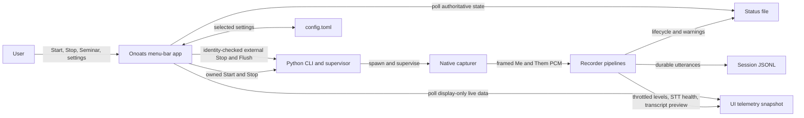
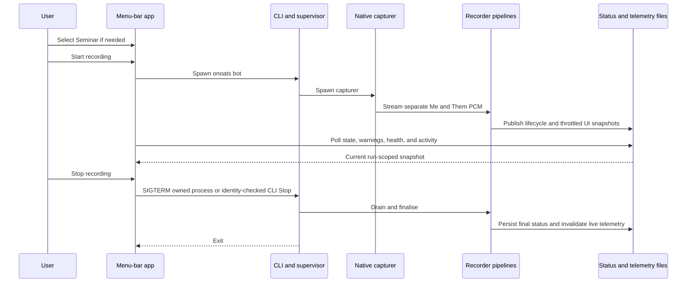

# Task: Onoats Menu-Bar Control Panel and Brand Mark

**Status**: Not Started
**Component**: recorder, stt, macos, packaging
**Assigned to**: Codex
**Priority**: High
**Branch**: feature/menubar-control-panel
**Created**: 2026-10-28
**Review Gates**: full

## Objective

Replace Onoats.app's flat menu with a compact window-style recording panel centred on Start, Stop, and the optional Seminar lock. Add truthful live status, reorganise infrequent controls under an in-panel settings view, and establish a reusable Onoats brand mark plus a monochrome macOS menu-bar icon without changing recorder safety contracts.

## Context

The current SwiftUI `MenuBarExtra` uses the default menu presentation. It places lifecycle controls, Seminar, device selection, STT selection, storage paths, diagnostics, and Quit in one flat list. The product owner confirmed the primary menu-bar workflow is narrower: open the menu-bar item, optionally select Seminar, then Start or Stop. Phase 1 validates that hierarchy in the signed native smoke before it becomes final.

The recorder already exposes authoritative process liveness, warnings, start time, device names, and a running STT label. It does not expose per-branch activity, structured STT health, or a safe last-transcript preview. Those values must come from the runtime that owns the audio and STT connections; Swift must not infer them from an endpoint probe or stale session file.

This repository contains no website source or existing logo assets. This plan creates canonical brand assets and integrates them into Onoats.app. Applying the brand to onoats.app itself remains a separate repository task once that checkout is identified.

Explore facts in this plan are point-in-time contract facts. A later correction to a verified path, pattern, or dependency invalidates the review marker and requires `/review-plan` again.

## Requirements

- Use `.menuBarExtraStyle(.window)` and a compact fixed-width panel.
- Make Start or Stop the dominant control. Preserve its current lifecycle routing:
  - app-owned Stop terminates the retained supervisor `Process` gracefully;
  - external-session Stop invokes identity-checked `onoats stop`;
  - Flush invokes identity-checked `onoats flush`.
- Show the Seminar control only before Start. Preserve its next-session-only, in-memory, reset-on-exit semantics. Show a read-only Seminar badge during a locked session.
- Keep warnings, failure detail, schema drift, external-session state, stopping/draining state, and login-item hints visible and accessible.
- Keep STT operational state visible on the main panel. Put the STT service picker and advanced endpoint access inside the settings view.
- Move microphone selection, data-directory selection, config access, CLI diagnostics, and Quit into an in-panel settings view reached by a gear button.
- Preserve `config.toml` as the shared source of truth for recorder settings. UI-only presentation preferences may use `UserDefaults`.
- Do not add a launch-at-login toggle. `config.toml` remains its only control surface.
- Show Me/Them activity only when runtime telemetry is fresh. Never convert missing or stale data into a healthy signal.
- Scope new activity telemetry to the CoreAudio/socket path used by Onoats.app. Preserve PortAudio and `bot-single` as unchanged CLI compatibility paths; an externally started unsupported session shows activity unavailable.
- Present one combined STT row for the menu-bar app's two required branches: `failed` if either fails, `recovering` if either recovers, `starting` if either starts, `unknown` if either lacks confirmation, and `ready` only when both confirm ready. Show branch detail only when the aggregate is not ready.
- Make the last-transcript preview opt-in and off by default. Bound its length and keep the full transcript only in the existing session JSONL.
- Keep the lifecycle status schema at v2. Live display telemetry uses its own versioned, ephemeral contract.
- Telemetry failures must fail open: they may degrade the panel, but must never stop capture, STT, transcript persistence, or shutdown.
- Preserve never-mix, no-PortAudio-on-socket, bounded transport, status/PID ordering, graceful drain, and Swift/Python parity invariants.
- Create two related but distinct visual assets:
  - a full Onoats brand mark/wordmark for the app header and future website use;
  - a monochrome template icon that remains legible at macOS menu-bar sizes.
- Keep canonical vector brand sources in the repository. Commit required native exports and copy them explicitly into the signed app bundle.
- Pin status, PID, and telemetry reads to the active session's data directory until that recorder exits. A changed configured directory applies on the next Start.
- When the configured directory changes mid-session, show both `Recording to: <active>` and `Next recording: <configured>` in the panel until convergence.
- Expose `Open Log` on warning/failure surfaces and expose both `Open Log` and `Show Logs Folder` under Settings → Diagnostics. Fall back to the folder when the log file does not exist; do not embed a live log tail.
- Do not change the website in this plan because its source is not present in this checkout.

## Review Focus

- Verify that UI changes preserve identity-checked Stop/Flush, authoritative PID liveness, and draining-state behaviour.
- Verify telemetry ownership, freshness, atomic replacement, bounded update rate, owner-checked cleanup, and fail-open error handling.
- Verify audio-level instrumentation cannot mix Me and Them or bypass transport backpressure.
- Verify STT colours never claim endpoint health from configuration, process existence, or an independent Swift probe.
- Verify transcript-preview privacy, truncation, file permissions, and stale-session rejection.
- Verify native resources remain inside the explicitly signed bundle and do not alter its bundle identifier or designated-requirement strategy.
- Verify every cross-language literal or field has parity coverage and that the lifecycle status schema remains unchanged.
- Verify the native manual smoke matrix covers keyboard access, VoiceOver labels, panel dismissal, and all existing actions.
- Verify the menu-bar scope does not add telemetry requirements to PortAudio or `bot-single`.
- Verify log actions open only the canonical log file/folder and never render log content inside the popover.

## Implementation Checklist

### Phase 1: Brand Direction and Canonical Assets (manual design gate; not `/conduct`-driven)

**Goal:** Approve one recognisable Onoats mark before native integration. The full brand and the menu-bar glyph must share a visual idea without forcing a detailed colour logo into an 18-point monochrome slot.

- Produce two or three compact directions based on an oat-grain/speech-waveform motif.
- Review each direction at website/header scale and at 16, 18, and 22 point monochrome menu-bar scale.
- Obtain user approval for one direction before creating production exports.
- Create the new `assets/brand` and `native/onoats-menubar/Resources` directories explicitly.
- Add canonical SVG mark and wordmark sources plus documented colour, spacing, and monochrome rules.
- Export the app-header image, template menu icon at 1x/2x, and `.icns` app icon.
- Record export sizes and source-to-export mapping so later website work can reuse the same source.

### Phase 2: Ephemeral UI Telemetry Contract and Runtime Producer

**Impl files:** `src/onoats/ui_telemetry.py, src/onoats/transports/socket_audio.py, src/onoats/dual.py, src/onoats/processors/transcript_buffer.py, src/onoats/runtime.py, src/onoats/status.py, src/onoats/stt/websocket_stt_service.py`
**Test files:** `tests/test_ui_telemetry.py, tests/test_socket_audio_transport.py, tests/test_dual_socket_source.py, tests/test_websocket_stt_reconnect.py, tests/test_speaker_labels.py, tests/test_status_file.py, tests/test_socket_supervisor.py`
**Test command:** `uv run pytest tests/test_ui_telemetry.py tests/test_socket_audio_transport.py tests/test_dual_socket_source.py tests/test_websocket_stt_reconnect.py tests/test_speaker_labels.py tests/test_status_file.py tests/test_socket_supervisor.py -q`
**Goal:** Runtime telemetry is display-only, branch-safe, stale-rejectable, bounded, and incapable of affecting recorder success or transcript durability.

- Add a separate schema-v1 `.active/onoats.ui.json` snapshot. Do not add fields to `StatusRecord` or bump `STATUS_SCHEMA_VERSION`.
- Define one exact record shape shared by Python tests and Swift decoding: schema, recorder PID/start epoch, update time, optional Me/Them levels, per-branch plus aggregate STT state/detail, optional bounded transcript preview/source/speaker label, and locked category.
- Write snapshots by same-directory temporary file plus `os.replace`, with owner-only permissions. Because the file is ephemeral, do not `fsync` every meter update.
- Define Python-owned constants and mirror them in Swift: schema `1`, file name `onoats.ui.json`, mode `0o600`, maximum write rate `4 Hz`, unchanged-state heartbeat `2 s`, stale expiry `5 s`, transcript limit `240` Unicode code points, detail limit `256` Unicode code points, and level range `[0.0, 1.0]`.
- Let audio/STT/transcript callbacks update memory only. Coalesce changed snapshots and heartbeats through one bounded background task; no callback performs filesystem I/O or awaits persistence.
- Suppress redundant intermediate snapshots, but write an unchanged heartbeat every 2 seconds so healthy telemetry never expires.
- Reject non-finite or out-of-range level values and clamp accepted levels to `[0, 1]` at the publisher boundary.
- Construct telemetry only for `audio_source == "socket"`. Inject source-labelled level observers into the two existing socket transports; keep the transport generic and preserve one socket to one branch. PortAudio and `bot-single` remain unchanged.
- Publish transcript preview data from final `TranscriptionFrame` handling without changing JSONL entries or render-time speaker composition.
- Track mic and system STT state independently. Aggregate by fixed precedence `failed > recovering > starting > unknown > ready`; `ready` requires both branches ready. Use `unknown` for backends without a trustworthy confirmation hook.
- Sanitize STT detail through existing URI/exception redaction before it reaches telemetry.
- Mint one run epoch before PID/status publication. Pass the exact value to the PID file, lifecycle status, telemetry ownership, and cleanup; enable telemetry writes only after PID then running-status publication succeeds.
- Make producer and cleanup errors warning-only. Cleanup may unlink only a snapshot that still belongs to the same PID/start epoch.
- Rate-limit repeated write/cleanup warnings, log one recovery after writes resume, and test both with a fake clock.
- Invalidate or remove live telemetry after the recorder writes its stopped status; a leftover file remains harmless because consumers reject stale ownership/freshness.

### Phase 3: Swift Telemetry Consumer (manual native phase; not `/conduct`-driven)

**Goal:** The menu app accepts only fresh telemetry for the same live recorder and degrades to neutral UI without changing recorder liveness.

- Add a Swift mirror of the UI telemetry schema without modifying the existing `StatusRecord` mirror.
- Resolve the configured directory while stopped. On the first verified live identity, pin its active directory until that PID/start epoch exits; read status, PID, and telemetry only from the pinned directory during the run.
- Retain the changed configured directory as `nextDataDir` and publish active/next display values when they differ.
- Accept telemetry only when schema, PID, start epoch, freshness window, numeric ranges, and optional-string bounds pass validation.
- Keep PID identity/liveness authoritative. Telemetry must never create `.running`, `.stopped`, or `.failed` state.
- Clear activity, STT health, category badge, and preview when telemetry is missing, stale, malformed, or owned by another run.
- Poll live telemetry at 4 Hz and animate between samples; keep status/PID polling at its existing cadence.
- Persist only the transcript-preview visibility preference in `UserDefaults`, defaulting to off.
- Add source-reading parity tests for the telemetry schema, allowed STT states, bounds, and file name.
- Add a small native decoder harness with shared JSON fixtures. Execute valid, malformed, stale, foreign-owner, boundary, and non-finite cases instead of relying only on source-reading tests.
- Compile with `make -C native build/Onoats` after each model change.

### Phase 4: Native Resource Pipeline and Stateful Menu Icon (manual native phase; not `/conduct`-driven)

**Goal:** The brand assets are copied and signed predictably, while the menu icon remains a valid macOS template image with distinct recorder states.

- Recreate the staging `Onoats.app` bundle before assembly so stale resources cannot survive an earlier build.
- Extend `native/Makefile` to create `Contents/Resources` and copy each named resource explicitly before signing.
- Verify the staged Resources directory against an explicit allowlist and fail on missing or unexpected entries.
- Add `CFBundleIconFile` without changing `CFBundleIdentifier`, executable names, deployment floor, or TCC usage strings.
- Load the custom menu glyph as a template image. Express recording, warning, starting/stopping, and failed states through restrained overlays or variants that remain legible in light and dark menu bars.
- Use the full brand mark only in the panel header and app icon, never as a detailed colour menu-bar image.
- Add release-metadata/source-reading assertions for resource names, bundle-copy steps, template handling, and Info.plist icon metadata.
- Verify the assembled bundle contains every resource before codesigning and that `codesign --verify --deep --strict` succeeds after signing.
- Capture the installed app's designated requirement before assembly and byte-compare it with the staged signed bundle before installation.

### Phase 5: Window-Style Recording Panel and In-Panel Settings (manual native phase; not `/conduct`-driven)

**Goal:** Opening the menu-bar item makes Start, Stop, and Seminar immediately obvious while preserving every existing action and warning surface.

- Apply `.menuBarExtraStyle(.window)` and replace the flat `MenuContent` with a fixed-width main panel plus an in-panel settings destination.
- Main stopped/failed state: brand header, concise readiness/failure state, warning banners, Seminar toggle, and a full-width Start button.
- Main running state: elapsed time, read-only Seminar badge when locked, Me/Them CoreAudio activity rows, one aggregated STT state with unhealthy branch detail, optional one-line transcript preview, full-width Stop, and secondary Flush.
- If active and configured data directories differ, show `Recording to: <active>` and `Next recording: <configured>` until the active recorder exits.
- Keep Start disabled when the CLI is unavailable. Keep Stop disabled only for the existing in-flight external-stop guard.
- Preserve the distinction between app-owned and external sessions, including the “started outside the menu bar” disclosure. Unsupported external capture paths show activity unavailable without gaining new telemetry requirements.
- Settings: microphone picker, system-output display, STT service picker, Open `config.toml`, data-directory picker, transcript-preview toggle, and Quit/Stop & Quit.
- Settings → Diagnostics: Open Log, Show Logs Folder, CLI path/status, active data directory, and next-recording directory. `Open Log` opens the canonical file or falls back to the folder when absent.
- Warning and failure surfaces include an `Open Log` action. Do not tail or render log contents inside the popover.
- The main panel shows the existing Python-produced, redacted running `sttLabel`. While stopped, settings show only the configured service; advanced endpoint editing and resolution remain config/runtime work.
- Treat advanced STT endpoint editing as config-file work in this release; do not add a partial editor that can leave `ws_socket`, `ws_uri`, `ws_host`, and `ws_port` in conflict.
- Keep “changes apply on next Start” next to controls that write recorder configuration.
- Give every icon-only control an accessibility label and tooltip. Define a deterministic focus order and keyboard activation for Start/Stop, Seminar, settings/back, and Flush.
- Render long warnings in a bounded, wrapping region without changing the delimiter grammar pinned by Python tests.

### Phase 6: Documentation, Historic Decision Corrections, and End-to-End Verification

**Impl files:** `README.md, native/README.md, docs/dev_plans/20260609-feature-milestone-b-macos-capture-menubar.md, docs/dev_plans/20260925-feature-menubar-seminar-toggle.md`
**Test files:** `tests/test_native_contract_parity.py, tests/test_status_file.py, tests/test_release_meta.py`
**Test command:** `uv run pytest tests/test_native_contract_parity.py tests/test_status_file.py tests/test_release_meta.py -q`
**Validation cmd:** `python3 scripts/check_review_markers.py && make -C native build`
**Goal:** Documentation describes the final control hierarchy and telemetry contract without rewriting historical implementation logs or weakening reviewed-plan markers.

- Update README/native documentation for the window panel, common Start/Stop/Seminar flow, settings/diagnostics location, telemetry meanings, privacy default, active/next directory disclosure, log actions, and logo asset ownership.
- Grep `docs/dev_plans/` for menu-bar, Seminar, status, telemetry, and branding references.
- Append only concise dated corrections to historic plans whose recorded UI decisions are materially superseded; preserve their original history and review markers.
- Run `uv run ruff format` and `uv run ruff check` before the full suite.
- Run `uv run pytest` in full.
- Build the unsigned compile-smoke binaries with `make -C native build`.
- Run pre-merge documentation, code, security, and full review gates before final signing. Apply every accepted fix, then rerun affected focused tests and native smoke cases.
- Assemble and sign a staged Onoats.app, verify its resource allowlist, signature, and byte-identical designated requirement, then perform the manual smoke matrix against that staged bundle before installation.
- Before installation, record the installed app path/version, CLI path/version, and a recoverable app backup. Install app and CLI as one pair; if post-install smoke fails, restore the prior app and CLI pairing and verify it starts.
- Run the post-install smoke only after the staged bundle passes. Installation is not the first acceptance test.
- Before any commit, inspect only explicitly staged paths for secrets, credentials, private transcripts, PII, and unintended binary metadata.

## Technical Specifications

### Files to Modify

- `native/onoats-menubar/Sources/OnoatsMenuBarApp.swift` — window-style scene, main-panel state, stateful template icon.
- `native/onoats-menubar/Sources/RecorderModel.swift` — telemetry state, pinned active/next directories, log/folder actions, validated refresh integration, retained lifecycle actions.
- `native/onoats-menubar/Sources/ConfigStore.swift` — only if settings navigation needs an existing-key read/write helper; do not broaden it into a full TOML parser.
- `native/onoats-menubar/Info.plist` — app icon metadata only.
- `native/Makefile` — explicit resource assembly and verification inputs.
- `src/onoats/transports/socket_audio.py` — optional source-labelled audio-observation callback after frame validation.
- `src/onoats/dual.py` — telemetry lifecycle, branch wiring, STT state wiring, owner-checked shutdown.
- `src/onoats/processors/transcript_buffer.py` — optional finalized-utterance observation hook.
- `src/onoats/runtime.py` — backend-neutral STT state publication around service creation/preflight.
- `src/onoats/status.py` — accept the one caller-minted run epoch without changing the v2 field shape.
- `src/onoats/stt/websocket_stt_service.py` — confirmed connection/recovery callbacks without changing reconnect semantics.
- `tests/test_socket_audio_transport.py` — callback isolation, branch identity, invalid PCM and backpressure regression coverage.
- `tests/test_dual_socket_source.py` — Me/Them telemetry routing without audio mixing.
- `tests/test_websocket_stt_reconnect.py` — confirmed health, recovery, failure, and redaction transitions.
- `tests/test_speaker_labels.py` — transcript preview source/speaker rendering parity where applicable.
- `tests/test_native_contract_parity.py` — separate telemetry-schema and Swift-decoder parity.
- `tests/test_status_file.py` — lifecycle status remains v2 and warning rendering remains intact.
- `tests/test_socket_supervisor.py` — shared run epoch, identity publication order, shutdown cleanup, and paired status/PID evidence.
- `tests/test_release_meta.py` — resource and Info.plist bundle contract.
- `README.md`, `native/README.md` — user and maintainer documentation.
- `docs/dev_plans/20260609-feature-milestone-b-macos-capture-menubar.md` — dated correction only if its menu-presentation decision is stale.
- `docs/dev_plans/20260925-feature-menubar-seminar-toggle.md` — dated correction preserving Seminar semantics while relocating the control.

### New Files to Create

- `src/onoats/ui_telemetry.py` — ephemeral schema, bounded publisher, atomic writer, tolerant reader, and owner-checked cleanup.
- `tests/test_ui_telemetry.py` — contract, freshness, throttling, ownership, atomicity, permissions, failure, and cleanup tests.
- `native/onoats-menubar/Sources/UiTelemetry.swift` — strict Swift decoding and freshness/ownership validation.
- `native/onoats-menubar/Sources/RecordingPanelView.swift` — main recording-control panel.
- `native/onoats-menubar/Sources/SettingsPanelView.swift` — in-panel settings destination.
- `native/onoats-menubar/Tests/UiTelemetryDecoderHarness.swift` — executable strict-decoder harness for shared JSON fixtures.
- `tests/fixtures/ui_telemetry/` — shared valid, malformed, stale, foreign-owner, boundary, and non-finite JSON vectors.
- `native/test_ui_telemetry.sh` — compile and run the decoder harness on macOS without introducing Swift Package Manager.
- `assets/brand/onoats-mark.svg` — canonical standalone mark.
- `assets/brand/onoats-wordmark.svg` — canonical mark plus wordmark.
- `assets/brand/README.md` — palette, clear space, small-size, export, and template-icon rules.
- `native/onoats-menubar/Resources/OnoatsHeader.png` and `OnoatsHeader@2x.png` — panel header exports.
- `native/onoats-menubar/Resources/OnoatsMenuBarTemplate.png` and `OnoatsMenuBarTemplate@2x.png` — monochrome template exports.
- `native/onoats-menubar/Resources/Onoats.icns` — Finder, permissions, and app identity icon.

### UI Telemetry Contract

- Path: `<data_dir>/.active/onoats.ui.json`.
- Schema: independent integer `1`; it does not share `STATUS_SCHEMA_VERSION`.
- Ownership tuple: recorder PID plus one caller-minted run epoch shared byte-for-byte with PID line 4 and lifecycle `start_time`.
- Freshness: maximum 4 writes per second, heartbeat at least every 2 seconds, and consumer expiry after 5 seconds. Swift also requires the authoritative PID record to be live.
- Activity: optional normalized peaks for `me` and `them`. Missing means unknown, not zero and not healthy.
- STT state: mic/system each use `starting | ready | recovering | failed | unknown`; aggregate precedence is `failed > recovering > starting > unknown > ready`, and ready requires both branches.
- Transcript preview: optional text capped at 240 Unicode code points plus canonical source and render-time speaker label. It never replaces the durable JSONL entry.
- STT detail: optional, redacted, and capped at 256 Unicode code points.
- File mode: `0o600`; level values are finite and within `[0.0, 1.0]`.
- Category: optional locked category. The panel renders a Seminar badge only for the exact canonical Seminar category.
- Durability: none. Writes are atomic but deliberately not fsynced. The file may disappear or be stale after a crash.
- Failure policy: best-effort and warning-only. Repeated failures are rate-limited.

### Architecture Decisions

- Keep lifecycle status and UI telemetry separate. Status remains low-frequency and authoritative; telemetry remains ephemeral and display-only.
- **Decision (grilled):** Scope new meters and telemetry to Onoats.app's CoreAudio/socket session. Preserve PortAudio and `bot-single` without new UI telemetry requirements; show unavailable for unsupported external sessions.
- **Decision (grilled):** Combine the menu-bar app's two STT instances into one row. Green requires both ready; unhealthy states expose branch detail.
- **Decision (grilled):** Publish at 4 Hz maximum, heartbeat every 2 seconds, and expire after 5 seconds to balance meter response and filesystem load.
- **Decision (grilled):** Pin the active data directory until recorder exit. When settings change it mid-run, show active and next-recording paths.
- **Decision (grilled):** Show Python's redacted running STT label on the main panel. Keep the service picker and config-file endpoint access in settings.
- **Decision (grilled):** Offer Open Log plus Show Logs Folder. Warnings link to the file, with folder fallback; the popover never tails logs.
- Compute Me/Them peaks after socket-frame validation and before staging. The callback receives its source from branch construction, not from mutable frame metadata.
- Keep audio callbacks memory-only and coalesce persistence through one bounded background task. UI animation interpolates between bounded snapshots.
- Let Python publish STT state. Swift performs no network probe and does not duplicate authentication, URI, reconnect, or launchd logic.
- Keep endpoint editing in `config.toml` for this release. The main panel uses the existing runtime-produced `sttLabel`; settings expose the configured service and Open Config.
- Keep transcript preview off by default in `UserDefaults`; this preference affects presentation only and never changes transcript persistence.
- Keep advanced/settings navigation inside the menu-bar popover. Do not create a separate Dock-visible window or move common actions out of the panel.
- Treat the website as an external consumer of canonical SVG exports. Do not invent a website path in this checkout.
- Preserve the direct-`swiftc` build. New Swift source files remain covered by the existing source glob; resources require explicit copy rules.

### Dependencies

- No new Python, Swift-package, or web dependencies.
- Existing relevant versions: Python `>=3.12`, `pipecat-ai` `>=1.3.0,<2.0.0`, `websockets>=13.0`, `pytest>=8`, and `ruff>=0.15,<0.16` from `pyproject.toml`.
- Native compilation continues to use macOS system SwiftUI, AppKit, CoreAudio, AVFoundation, and AudioToolbox frameworks with a macOS 14.4 deployment floor.
- There is no `Package.swift`; native code continues to compile through `native/Makefile`.

### Integration Seams

| Seam | Writer | Caller | Contract |
|---|---|---|---|
| Audio activity | Socket input transport | UI telemetry publisher | Validated PCM, fixed branch source, no await/backpressure mutation, normalized finite peak |
| Transcript preview | `TranscriptBuffer` | UI telemetry publisher | Final non-empty utterance, bounded copy only, durable JSONL unchanged |
| STT health | Two runtime STT instances | UI telemetry publisher | Branch-labelled states, fixed aggregate precedence, both-ready green rule, redacted details |
| UI snapshot | UI telemetry publisher | Swift telemetry reader | Atomic schema-v1 JSON, 4 Hz cap, 2 s heartbeat, 5 s expiry, shared PID/epoch, mode 0600 |
| Lifecycle state | Status/PID files | `RecorderModel` | PID identity remains authoritative; telemetry cannot change recorder state |
| Recorder settings | Swift `ConfigStore` | Python config loader | Existing narrow TOML edits preserve unrelated content; pin active directory and apply new directory next Start |
| Diagnostics | Canonical log path | Panel and settings | Open file when present, otherwise reveal folder; never tail content in the popover |
| Native assets | Canonical SVG/exports | Makefile and Swift panel | Explicit filenames, template semantics, resource copy before signing |
| Historic plans | Current plan | Prior decision records | Dated correction and cross-link only when a prior decision is materially superseded |

## Architecture & Call Flow

| Step | Trigger | Enters context | Cleared/persisted | Turn boundary |
|---|---|---|---|---|
| 1 | App launches or panel opens | PID identity, status, config, telemetry freshness | Model persists for app lifetime | Panel renders |
| 2 | User starts | Seminar choice and shared configuration | Session/run identity persists until exit | Recorder becomes live |
| 3 | Capture proceeds | Separate Me/Them audio, STT state, utterances | JSONL persists; UI telemetry is throttled and session-scoped | Each atomic snapshot |
| 4 | User stops | Graceful-stop request and drain state | Transcript persists; live telemetry is invalidated; final status remains | Supervisor exits |

## Testing Notes

### Automated Test Approach

- Unit-test UI telemetry schema, numeric validation, truncation, permissions, atomic replacement, throttling, freshness, owner-checking, cleanup, and fail-open writes.
- Mutation-test ownership/freshness by substituting stale PID, same PID with a different start epoch, stale update time, schema drift, malformed JSON, and non-finite levels. Assert the one minted epoch is identical in PID, status, and telemetry.
- Fake-clock changed writes, unchanged 2-second heartbeats, 4 Hz suppression, 5-second expiry, repeated-failure warning suppression, recovery logging, and fail-open cleanup.
- Exercise the menu-bar source matrix: Me/Them, socket telemetry present/absent, unsupported external capture, transcript preview enabled/disabled, and owned/external session. PortAudio and `bot-single` remain outside new telemetry scope.
- Assert level callbacks preserve one socket to one branch and do not alter staging, byte caps, drop policy, or fatal error behaviour.
- Assert every mic/system STT state pair and callback ordering against the fixed aggregate precedence, including startup, recovery, confirmation, auth/protocol failure, and unknown backend support.
- Assert URI userinfo/query secrets cannot reach the telemetry file or Swift display.
- Source-read Swift contracts and execute the native decoder harness against shared JSON vectors for telemetry fields, allowed states, exact bounds, freshness, ownership, and rejection cases.
- Keep existing status, CLI, socket, supervisor, diarization, release metadata, and parity suites green.

### Manual Native Smoke Matrix

- Stopped: panel opens at a stable size; Seminar is editable; Start is dominant; settings are reachable and return preserves state.
- Starting/running/stopping/failed: every transition has a truthful label and the main action cannot double-fire.
- Owned and external sessions: Stop follows the correct path; Flush still works; draining never renders as stopped early.
- Seminar: selected before Start, shown read-only during recording, passed as `--category seminars`, and reset after exit.
- Me/Them: speak/play each side independently; only its meter responds; silence decays; stale telemetry becomes unknown.
- STT: confirmed ready, recovering, failed, and unknown render distinct states without false green.
- Transcript preview: off by default; enabling shows one bounded latest line; disabling removes it immediately; stale prior-run text never appears.
- Warnings: all-zero input, STT recovery, login-item hint, schema drift, Flush/Stop failure, and failed-session detail wrap without panel expansion.
- Settings: microphone, STT service, data directory, config open, CLI diagnostics, and Quit/Stop & Quit retain current behaviour.
- Directory transition: change the configured directory during a run; confirm the panel keeps reading the active directory, shows active/next paths, and adopts the new directory only after the next Start.
- Diagnostics: Open Log opens the canonical file; Show Logs Folder reveals the folder; absent-file Open Log falls back to the folder; no transcript/log tail appears in-panel.
- Dismissal: Escape and click-away close the panel; reopen and settings/back preserve correct state while recording continues.
- Accessibility: Tab/Shift-Tab focus order, Space/Return activation, VoiceOver labels, tooltip text, contrast, Reduce Motion, and light/dark menu bars.
- Branding: header and app icon render sharply; custom menu icon remains legible at supported scales and shows each state.
- Bundle: staged signed app passes resource allowlist and codesign checks; before/after `codesign -dr` outputs are byte-identical; installation retains microphone/system-audio grants.

### Test Results

- [ ] Focused telemetry and parity tests pass.
- [ ] `uv run ruff format` and `uv run ruff check` pass.
- [ ] Full `uv run pytest` passes.
- [ ] `make -C native build` passes.
- [ ] `native/test_ui_telemetry.sh` passes on macOS.
- [ ] Signed bundle verification passes.
- [ ] Designated-requirement bytes match the installed baseline.
- [ ] Manual native smoke matrix passes.

## Acceptance Criteria

- The menu-bar item opens a window-style panel whose dominant action is Start when stopped and Stop when running.
- Seminar is one interaction away before Start, remains next-session-only, and displays read-only during a locked run.
- Every existing control remains available either on the main panel or in its settings destination.
- Owned Stop, external Stop, Flush, Quit, liveness, warnings, and drain semantics remain unchanged and covered.
- Me/Them indicators use separate fresh CoreAudio/socket values; stale, missing, malformed, or unsupported external telemetry renders unavailable.
- The primary combined STT row never shows green unless both menu-bar branches confirm ready; non-ready states identify unhealthy branches.
- Transcript preview is opt-in, bounded, redacted where applicable, and never leaks a previous run.
- Telemetry writes are versioned, atomic, mode 0600, capped at 4 Hz, heartbeated every 2 seconds, expired after 5 seconds, owner-checked, asynchronously coalesced, and fail open.
- PID, lifecycle status, and telemetry carry one identical caller-minted run epoch; telemetry begins only after authoritative identity publication.
- Changing the data directory during a run leaves the active session pinned, shows active/next paths, and applies on the next recording.
- Warning/failure surfaces can open the canonical log; Settings → Diagnostics can open the file or reveal its folder without embedding log content.
- `STATUS_SCHEMA_VERSION` remains 2 and all existing Swift/Python parity tests pass.
- A user-approved canonical SVG brand, app icon, and monochrome template menu icon are committed with reuse guidance.
- The assembled clean staged app contains only allowlisted resources and passes signature plus byte-identical designated-requirement verification before installation.
- README/native docs describe the final UI and telemetry meanings; only materially superseded historic decisions receive dated corrections.
- Focused tests, full pytest, Ruff format/check, review-marker validation, native compile, signed-app verification, and manual smoke all pass.
- Pre-merge documentation, code, security, and full review gates report no unresolved findings.

<!-- reviewed: 2026-10-28 @ 32e48ea9fc76b7efd408c103f5c8f08913fc5da4 -->

## Progress

- [ ] Phase 1: Brand Direction and Canonical Assets
- [ ] Phase 2: Ephemeral UI Telemetry Contract and Runtime Producer
- [ ] Phase 3: Swift Telemetry Consumer
- [ ] Phase 4: Native Resource Pipeline and Stateful Menu Icon
- [ ] Phase 5: Window-Style Recording Panel and In-Panel Settings
- [ ] Phase 6: Documentation, Historic Decision Corrections, and End-to-End Verification

## Findings

- (append findings here as work proceeds)

## Issues & Solutions

- (append issues and resolutions here as work proceeds)

## Final Results

### Summary

- (fill when complete)

### Outcomes

- (fill when complete)

### Learnings

- (fill when complete)

### Follow-up Work

- Integrate the approved canonical brand assets into the onoats.app website after its repository/path is identified.
