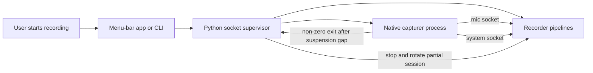

# Task: Recover or Fail Loud When the System Tap Stalls After Process Resume

**Status**: In Progress
**Component**: macos, transport, recorder
**Assigned to**: Codex
**Priority**: High
**Branch**: bug/capturer-system-tap-resume
**Created**: 2026-11-07
**Review Gates**: full

## Objective

Ensure the native system-audio capturer cannot remain apparently healthy after
its active pacer misses more than two seconds of process uptime. That heartbeat
stall makes the Core Audio tap generation untrustworthy: the capturer must stop
emitting, attempt ordered cleanup, and terminate with a distinct non-zero code
within two further seconds so the supervisor rotates the partial session. A
later Start creates a wholly fresh generation.

## Context

Signed-app manual testing reproduced a Core Audio process-tap failure after
`SIGSTOP`/`SIGCONT`: telemetry freshness and STT recovered, but the `them`
branch remained silent and emitted `zero-run-warning` without
`zero-run-clear`. The current all-zero detector is warning-only because a
rendering application can legitimately output digital silence. Audio content
therefore cannot be the fatal signal. The reproducible independent signal is
the multi-second gap in the capturer's own 20 ms pacer after the process resumes.
That signal is deliberately named a **capturer heartbeat stall**, not proof of
`SIGSTOP`: scheduler starvation or a debugger pause can produce the same
process-uptime gap. `mach_absolute_time` does not advance during host sleep, so
ordinary sleep/wake is outside this detector and remains covered by the
existing device and socket contracts.

## Requirements

- Preserve never-mix: system tap audio can reach only the system socket and
  `them` STT session.
- Preserve legitimate idle playback and digital silence; no watchdog may infer
  a fatal tap failure merely from the absence of callbacks or all-zero samples.
- After activation, a pacer wake gap **strictly greater than 2,000,000,000 ns**
  terminates the capturer without waiting for audio-content heuristics. A gap
  exactly equal to that threshold is allowed; a regressed clock resets the
  baseline and does not trigger.
- Preserve the supervisor as the sole owner of whole-generation restart; the
  native capturer must not reconnect sockets or silently create a second tap
  generation behind the recorder.
- Retain teardown ordering as best-effort cleanup: stop device, destroy IOProc,
  destroy aggregate, destroy tap, then close sockets through the existing
  single exit path. The heartbeat-fault path arms an independent hard-exit
  deadline before cleanup so a blocked Core Audio stop cannot exceed two
  seconds from fault admission to process exit.
- Preserve the existing first-terminal-event-wins rule. If SIGTERM/SIGINT is
  admitted first, graceful rc=0 remains authoritative; if the heartbeat fault
  is admitted first, its distinct non-zero code and hard deadline remain
  authoritative.
- Add and run a deterministic regression **before production edits**, record
  that red result below the review marker, then cover ordinary 20 ms wakes, the
  exact threshold, an over-threshold gap, re-arming, clock regression, one-shot
  terminal admission, both stop-race orderings, and the independent hard-exit
  deadline.
- Verify the signed-app scenario with the supplied YouTube video as real
  system output after automated gates pass.

## Review Focus

- False-positive safety: paused playback, no callbacks, and intentional digital
  silence must not cause a restart; only a process heartbeat gap may escalate.
- Core Audio lifecycle: no duplicate IOProc, aggregate, tap, worker, or socket
  ownership during recovery.
- Process boundary: a detected stall must be non-zero and bounded so the
  supervisor reports truncation and owns the next generation.
- Realtime safety: the IOProc remains copy-only; no logging, Core Audio API
  call, allocation-heavy recovery, or contended recovery lock runs there.

## Implementation Checklist

### Phase 1: Suspension Watchdog and Deterministic Harness

**Impl files:** `native/onoats-capturer/Sources/ProcessSuspensionWatchdog.swift`
**Test files:** `native/onoats-capturer/Tests/ProcessSuspensionWatchdogHarness.swift, native/test_capturer_watchdog.sh`
**Test command:** `bash native/test_capturer_watchdog.sh`
**Validation cmd:** `make -C native build`
**Goal:** Create the previously absent `Tests/` directory and prove the pure
heartbeat and terminal-admission state space before wiring it into capture.

- Create the new native harness directory and first land/run the harness and
  shell driver without the production type, recording the expected compile
  failure below the marker before adding production code.
- Add a pure monotonic-gap state machine with a 2,000,000,000 ns threshold,
  strict-greater-than comparison, clock-regression reset, and one result per
  observed gap.
- Build a direct Swift harness for normal cadence, exact-boundary, over-boundary,
  re-arm, clock-regression, first-terminal-event admission, and both race
  orderings. Compile the new pure source in the normal native build too.

### Phase 2: Fail-Loud Native-to-Supervisor Boundary

**Impl files:** `native/onoats-capturer/Sources/Resampler.swift, native/onoats-capturer/Sources/SystemCapture.swift, native/onoats-capturer/Sources/Support.swift, native/onoats-capturer/Sources/main.swift, src/onoats/cli.py, native/Makefile`
**Test files:** `native/onoats-capturer/Tests/ProcessSuspensionWatchdogHarness.swift, native/test_capturer_watchdog.sh, tests/test_capturer_mic_liveness.py, tests/test_socket_supervisor.py, tests/test_native_contract_parity.py`
**Test command:** `bash native/test_capturer_watchdog.sh && uv run pytest tests/test_capturer_mic_liveness.py tests/test_socket_supervisor.py tests/test_native_contract_parity.py -q`
**Validation cmd:** `make -C native build`
**Goal:** An over-threshold heartbeat gap invalidates the entire native capture
generation and exits with `capture-heartbeat-stalled` through the one ordered
teardown owner; no socket reconnect or in-process tap rebuild occurs.

- Sample the pacer wake before taking the chunker lock, feed that timestamp to
  the watchdog after activation, stop the pacer on a trip, and invoke its
  terminal callback only after releasing the chunker lock. The IOProc remains
  copy-only and audio samples never enter the decision.
- Give production `SystemCapture` a terminal callback while leaving self-tests
  callback-free, and add Python source-shape pins for off-lock dispatch and the
  absence of system stale-data rebind.
- Add a distinct native exit code and Python supervisor mapping for
  `capture-heartbeat-stalled`; route the callback into `Teardown.shared.trigger`.
- Arm a separate two-second hard-exit timer before ordered cleanup on this
  non-zero fault path. Add an executable child-process self-test that blocks
  after arming the production deadline helper and proves the expected code is
  observed within the bound.
- Preserve idempotence with an explicit first-event admission gate and exercise
  watchdog-first and graceful-stop-first orderings in the Swift harness.
- Reuse the existing supervisor early-exit contract tests to prove partial
  rotation, non-zero status, and no transport self-reconnect.

### Phase 3: Contract Documentation and Live Verification

**Impl files:** `AGENTS.md, docs/audio-socket-contract.md, native/README.md, docs/dev_plans/20261028-feature-menubar-control-panel.md, docs/dev_plans/20261107-bug-capturer-system-tap-resume.md`
**Test files:** `scripts/check_review_markers.py`
**Test command:** `python3 scripts/check_review_markers.py && uv run ruff format && uv run ruff check && uv run pytest`
**Validation cmd:** `bash native/test_capturer_watchdog.sh && make -C native build`
**Goal:** Documentation and live behavior state the same boundary: process suspension fails the current generation; only a later explicit Start creates a new one.

- Update the native and socket contracts plus the root maintainer invariant.
- Append a dated correction to the historic control-panel plan without
  rewriting its original finding.
- Re-run the full local gates and inspect explicitly staged paths for secrets,
  PII, private transcripts, audio, credentials, and unintended binaries.
- Build and sign the app, play the supplied YouTube video, start recording,
  seek to the continuously audible interval starting at `00:30` in video ID
  `wykPErJ8M-8`, select the intended output route, set audible volume, confirm
  `them` activity, apply four seconds of STOP/CONT to the exact owned capturer
  generation, and verify the distinct bounded non-zero failure plus partial
  rotation.
- Before a fresh Start, run `native/residue_check.sh`, the capturer
  `list-taps`/`list-aggregates` maintenance commands, process/socket checks, and
  verify the failed generation left no tap, aggregate, capturer, or socket.
- Start a new recording and confirm the fresh tap again captures non-zero
  `them` audio from the same video.

## Technical Specifications

### Files to Modify

- `native/onoats-capturer/Sources/Resampler.swift` — feed the existing 20 ms
  pacer wake (sampled before its lock) into a process-suspension watchdog, stop
  emitting on a trip, and invoke its callback outside the chunker lock.
- `native/onoats-capturer/Sources/SystemCapture.swift` — accept a terminal
  callback for a suspension-detected, no-longer-trustworthy tap generation.
- `native/onoats-capturer/Sources/Support.swift` — own the new exit code, the
  first-terminal-event admission helper, and the independently scheduled
  hard-exit deadline helper used by production and its child-process self-test.
- `native/onoats-capturer/Sources/main.swift` — connect the system-capture
  terminal callback to the existing `Teardown.shared.trigger` non-zero path,
  arm the fault deadline before cleanup, and keep capture self-tests callback-free.
- `src/onoats/cli.py` — map the distinct native code to the stable
  `capture-heartbeat-stalled` status reason.
- `native/Makefile` — expose the direct Swift harness as a repeatable native
  test target while retaining wildcard production compilation.
- `tests/test_capturer_mic_liveness.py` — replace the old source pin requiring
  no system stale hook with shape checks for content-independent suspension
  detection and off-lock terminal dispatch.
- `docs/audio-socket-contract.md` — define suspension detection and the
  resulting fail-loud supervisor boundary.
- `native/README.md` — document operator-visible failure and manual
  STOP/CONT verification.
- `AGENTS.md` — record the load-bearing no-in-process-reconnect invariant.
- `docs/dev_plans/20261028-feature-menubar-control-panel.md` — append a dated
  correction below its review marker and cross-link this plan.

### New Files to Create

- `docs/dev_plans/20261107-bug-capturer-system-tap-resume.md` — reviewed bug-fix contract and evidence workspace.
- `native/onoats-capturer/Sources/ProcessSuspensionWatchdog.swift` — pure,
  clock-injected state machine that detects a pacer wake gap without examining
  audio samples or calling Core Audio.
- `native/onoats-capturer/Tests/ProcessSuspensionWatchdogHarness.swift` — direct
  Swift state-space harness for normal cadence, boundary, resume gap, re-arm,
  and clock-regression cases.
- `native/test_capturer_watchdog.sh` — compiles and runs the standalone watchdog
  harness without introducing a Swift package, then runs the production
  hard-exit helper in a child process and checks its code and elapsed bound.

### Architecture Decisions

- Detect a process heartbeat stall, not silence. `FrameChunker` already owns a
  20 ms pacer and observes a process-uptime gap after a long pause; bit-exact
  audio content remains warning-only. This policy does not claim the underlying
  cause and deliberately excludes host sleep time.
- **Decision (grilled):** fail the generation unconditionally for a wake gap
  strictly greater than two seconds; do not attempt in-process tap recovery.
  The supervisor already owns whole-generation restart.
- **Decision (grilled):** preserve first-terminal-event-wins. Graceful stop
  admitted before the watchdog keeps rc=0; a watchdog fault admitted first
  keeps its non-zero outcome and independent hard deadline.
- **Decision (grilled):** ordered Core Audio cleanup is best effort after a
  heartbeat fault. A separately scheduled hard exit caps the process at two
  seconds because cleanup calls can block and supervisor observation requires
  actual process/socket termination.
- Fail the generation instead of rebuilding Core Audio in place. The process
  tap is created once per session, socket transports never reconnect, and the
  Python supervisor already treats every premature capturer exit as non-zero,
  rotates the partial session, and tears down both branches.
- Keep detection pure and testable. A small watchdog consumes injected
  monotonic values and reports gaps; it owns no thread, timer, audio resource,
  socket, or teardown action.
- Dispatch terminal action only after releasing the chunker lock so teardown
  cannot reverse the chunker-to-writer lock order or stop the chunker while its
  pacer still holds that lock.

### Dependencies

- No new runtime dependency is expected; the native capturer uses Apple
  CoreAudio/AVFoundation APIs and the existing Python supervisor contract.

Verified create-time facts: package version `1.5.1` and Python `>=3.12` are
declared in `pyproject.toml`; `native/Makefile` targets macOS 14.4 and links
AVFoundation, CoreAudio, and AudioToolbox directly. No `Package.swift` exists.
These path, pattern, and dependency facts are part of the plan contract; a
later correction invalidates review and requires `/review-plan` again. Git refs
are point-in-time facts only: branch `bug/capturer-system-tap-resume` resolved
to `c233efefa335dd90ff97e3f1b94d220701fbe078` at creation, and PR #34's merge
commit `2e1c7b6cc647b8e9cd1b8c9002fcf9c1411bd17b` is an ancestor of that base.

### Integration Seams

| Seam | Writer (task) | Caller (task) | Contract |
|------|---------------|---------------|----------|
| Pacer heartbeat to watchdog | `FrameChunker` | `ProcessSuspensionWatchdog` | Wake time is sampled before the chunker lock. A normal 20 ms wake, exactly 2 s, host sleep, and audio content never trip; only a process-uptime gap greater than 2 s trips. |
| Watchdog to native teardown | `SystemCapture` | `main.swift` / `Teardown` | Callback runs outside the chunker lock, first terminal admission wins, and a fault exits with the distinct code within a separate 2 s deadline. |
| Capturer exit to session failure | native capturer | Python socket supervisor | Existing early-exit path stops both branches, rotates partial output, reports failure, and never reconnects the transport. |
| New generation | menu-bar app or CLI Start | Python supervisor | A later explicit Start mints a new socket directory and nonce and creates a new tap; no in-process tap replacement is attempted. |

## Architecture & Call Flow

Component graph — which process triggers which:



Trigger order — one reproduced suspension failure:

```mermaid
sequenceDiagram
    participant U as User or OS
    participant C as Native capturer
    participant W as Suspension watchdog
    participant S as Python supervisor
    participant R as Recorder
    U->>C: SIGSTOP then SIGCONT
    C->>W: first pacer wake after multi-second gap
    W-->>C: generation untrustworthy
    C->>C: ordered teardown and non-zero exit
    C-->>S: process exit plus socket EOF
    S->>R: cancel, finalise, rotate partial session
    S-->>U: failed recording; next Start required
```

Context lifecycle — what each process owns:

| Step | Trigger | Enters context | Cleared/persisted | Turn boundary |
|------|---------|----------------|-------------------|---------------|
| 1 | Start action | data directory, fresh socket paths, nonce | Persisted for one supervisor generation | Capturer and recorder launched |
| 2 | Capturer activation | tap, aggregate, IOProc, pacer baseline | Process-local until ordered teardown | Both sockets streaming |
| 3 | Pacer wake | current monotonic tick and prior tick | Tick replaces prior tick; no audio samples retained | Watchdog returns normal or gap |
| 4 | Gap detected | fixed failure reason and non-zero exit code | Log/status failure persists; native resources cleared | Capturer exits |
| 5 | Supervisor observes exit | immutable generation identity and partial session | Session rotates to `pending/`; sockets and nonce discarded | Process returns non-zero |
| 6 | Later explicit Start | entirely new paths, nonce, tap, aggregate, IOProc | New generation; no old native context reused | New recording begins |

## Testing Notes

### Test Approach

- [ ] Deterministic native/source contract regression for the watchdog state space.
- [ ] Focused Python/native contract and supervisor tests.
- [ ] Native build and full Python validation.
- [ ] Signed-app STOP/CONT manual verification using the supplied system audio.

### Test Results

- [ ] Pre-fix regression fails.
- [ ] Focused tests pass.
- [ ] Full validation passes.
- [ ] Manual verification passes or records a bounded fail-loud restart.

### Edge Cases Tested

- [ ] No rendered audio / no tap callbacks.
- [ ] Active callbacks with deliberate digital silence.
- [ ] Non-zero audio does not affect escalation.
- [ ] Exact 2 s gap is allowed; a greater gap fails the generation.
- [ ] Ordered cleanup completes before the hard deadline.
- [ ] Ordered cleanup blocks and the hard deadline exits non-zero.
- [ ] SIGTERM/SIGINT first and watchdog first race orderings.

## Acceptance Criteria

- After a four-second capturer suspension, the capturer stops emitting and exits
  with the distinct non-zero reason no later than two seconds after its first
  resumed pacer wake; indefinite warning-only silence is impossible.
- A normal paused player or digital-silence stream does not force a restart.
- The supervisor remains the only whole-generation restart owner, and every
  heartbeat fault rotates the partial session through existing fail-loud logic.
- No resource residue, duplicate tap chain, branch mixing, or unbounded wait is
  introduced.
- Focused tests, full tests, Ruff format/check, review-marker validation, and
  native build pass.
- Documentation, the plan, and PR description reflect the final failure and
  recovery semantics.

<!-- reviewed: 2026-11-08 @ 31ef9cee7a0e70c673a2e61d5f29335e4674cf0c -->

## Progress

- [ ] Phase 1: Suspension Watchdog and Deterministic Harness
- [ ] Phase 2: Fail-Loud Native-to-Supervisor Boundary
- [ ] Phase 3: Contract Documentation and Live Verification

## Findings

- 2026-11-07: live checkout was clean `main` at `c233efe`, the regular merge of
  PR #36. The older feature branch recorded the manual finding in `a721480`,
  but that commit was not part of the merged PR.
- 2026-11-08: the red-first native regression failed as intended before the
  production watchdog existed: `swiftc` could not open
  `Sources/ProcessSuspensionWatchdog.swift`. This proves the new harness does
  not pass against the pre-fix implementation.

## Issues & Solutions

- (append as implementation proceeds)

## Final Results

### Summary

- (fill when complete)

### Outcomes

- (fill when complete)

### Learnings

- (fill when complete)

### Follow-up Work

- (fill when complete)
