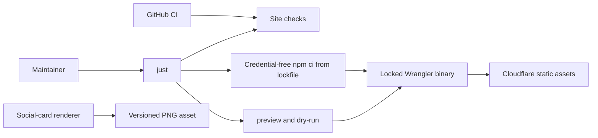
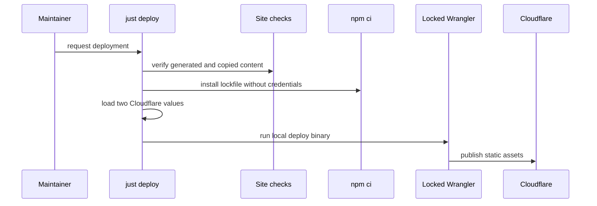

# Task: Landing-page deep-review remediation

**Status**: In Review
**Component**: website
**Assigned to**: Codex
**Priority**: High
**Branch**: feat/landing-page
**Created**: 2026-11-08
**Review Gates**: full

## Objective

Close every finding from the landing-page deep review while keeping the site static, dependency-locked, and reproducible.

## Context

The first deep review covered the landing site through commit `73097a3` and reported four Important and six Minor findings. Later commits added mobile overflow fixes, `robots.txt`, and `llms.txt`; this work preserves them. The current site has a prompt generator, a local `just` workflow, and a Cloudflare deployment path, but CI does not enforce the site contracts.

## Requirements

- CI must reject stale generated prompt HTML, drifting copied assets, and divergent shared navigation or footer content.
- Cloudflare deployment must execute a lockfile-resolved Wrangler binary. Dependency installation must finish before the recipe reads or exports deployment credentials.
- Raw daily transcripts must be labelled and delimited as untrusted data, with instruction precedence stated before the data.
- Optional prompt sections must remain separated from following fixed text even when callers omit trailing newlines.
- Immutable image caching must cover only versioned image URLs. The global response policy must include HSTS without `includeSubDomains` or preload.
- The social image must have a committed source owner and a documented regeneration command.
- Site documentation must use commands valid from the documented `site/` working directory.
- Existing responsive, crawler, and LLM-discovery files added after the reviewed snapshot must remain intact.

### Review finding map

| ID | Deep-review finding | Required closure |
|----|---------------------|------------------|
| R1 | Generated prompt HTML can drift on main. | `build_prompts.py --check` runs from `just check` and CI. |
| R2 | Site README generator paths contradict its working directory. | Every documented command resolves from `site/`. |
| R3 | Deployment installs an unlocked npm graph with credentials present. | npm uses a committed lockfile, ignores lifecycle scripts, and runs in a deny-by-default environment before credentials load. |
| R4 | Raw transcripts can override daily-digest instructions. | Trusted policy precedes a labelled, delimited untrusted transcript block. |
| R5 | Public asset copies lack synchronization checks. | The site checker byte-compares every declared canonical copy. |
| R6 | Shared page chrome has three owners. | The site checker compares navigation and footer blocks, allowing only `aria-current="page"`. |
| R7 | Social preview source and regeneration are undocumented. | A committed renderer and exact command own the versioned PNG. |
| R8 | Immutable caching covers an unversioned mark. | Every file under `public/img/` follows the versioned filename grammar. |
| R9 | Optional prompt placeholders can join fixed text. | Fixed newlines follow both optional placeholders. |
| R10 | The custom domain lacks HSTS. | The global header adds one-year HSTS without subdomain or preload scope. |

## Review Focus

- Verify that no package installation command receives Cloudflare credentials from this workflow.
- Verify prompt and asset checks run in both local `just check` and repository CI.
- Verify shared-page parity tolerates only the intentional `aria-current` difference.
- Verify every `/img/*` reference is versioned before retaining immutable caching.

## Implementation Checklist

### Phase 1: Static-site and prompt invariants

**Impl files:** `site/public/_headers, site/public/*.html, site/public/prompts/*, site/public/img/*, site/scripts/build_prompts.py, site/scripts/check_site.py`
**Test files:** `tests/test_site_contract.py`
**Test command:** `uv run pytest tests/test_site_contract.py -q`
**Validation cmd:** `python3 site/scripts/build_prompts.py --check && python3 site/scripts/check_site.py`
**Goal:** Generated content, copied assets, shared chrome, prompt boundaries, and cache policy must fail closed when they drift.

- Add the stdlib site checker and focused regression tests.
- Harden transcript and optional-section prompt boundaries, then regenerate the catalogue.
- Version the mark URL, add HSTS, and enforce shared-page and copied-asset parity.

### Phase 2: Locked deployment and reproducible operations

**Impl files:** `.github/workflows/ci.yml, site/package.json, site/package-lock.json, site/justfile, site/README.md, site/scripts/render_social_card.swift, site/public/img/onoats-social-1.6.0.png`
**Test files:** `tests/test_site_contract.py`
**Test command:** `uv run pytest tests/test_site_contract.py -q`
**Validation cmd:** `cd site && just deps && just dry-run`
**Goal:** Installation must use a lockfile without Cloudflare credentials; deployment alone may receive the two required values.

- Add a `deps` recipe that runs `npm ci --ignore-scripts` in a deny-by-default environment.
- Route preview, dry-run, and deploy through `deps` and the same local Wrangler binary.
- Add the site contract gate to CI and local `just check`.
- Commit and document the social-card renderer and correct all site operating commands.

## Technical Specifications

### Files to Modify

- `.github/workflows/ci.yml` — add the dependency-free landing-site contract gate.
- `site/justfile` — use lockfile installation and the local Wrangler binary; run every static-site check.
- `site/README.md` — correct command roots and document dependencies, asset ownership, social-card regeneration, and cache versioning.
- `site/public/index.html`, `site/public/prompts/index.html`, `site/public/404.html` — use the versioned mark and preserve parity-checked shared chrome.
- `site/public/_headers` — add HSTS and retain immutable caching only for versioned image URLs.
- `site/public/prompts/digest_daily.txt` — define the untrusted-transcript boundary.
- `site/public/prompts/classify_ap.txt`, `site/public/prompts/consolidate_action_items.txt` — add fixed placeholder separators.
- `site/scripts/build_prompts.py` — regenerate the committed prompt catalogue after prompt changes.

### New Files to Create

- `site/package.json`, `site/package-lock.json` — exact Wrangler dependency and npm integrity lock.
- `site/.node-version` — supported Node major for site maintenance and deployment.
- `site/scripts/check_site.py` — stdlib checks for shared chrome, copied assets, versioned image filenames, and headers.
- `site/scripts/install_locked_deps.sh` — deny-by-default npm installation boundary used by `just deps`.
- `site/scripts/render_social_card.swift` — committed macOS renderer that owns the 1200x630 PNG composition.
- `tests/test_site_contract.py` — focused regressions for the site checker and prompt boundaries.

### Architecture Decisions

- Keep the published site build-free. Validation scripts run before publication but emit no runtime JavaScript.
- Keep `build_prompts.py --check` as the sole prompt-parity owner. Local and CI orchestrators call it beside `check_site.py`.
- Compare direct asset copies byte-for-byte. Treat versioned screenshots as deliberate release snapshots with explicit source mappings.
- Compare shared navigation and footer blocks after removing only `aria-current="page"`; all other differences fail.
- Run `npm ci --ignore-scripts` with a deny-by-default environment containing only `HOME`, `PATH`, and a resolved temporary directory.
- Load Cloudflare values only after dependency installation, immediately before the locked Wrangler process.
- Require `site/public/img/` filenames to end in `-MAJOR.MINOR.PATCH` before the extension. Rename or delete every exception.

### Dependencies

- Node 24 in `site/.node-version` and npm `11.19.0` in `package.json#packageManager`.
- `wrangler` `4.158.0`, moved from a justfile-only pin into `site/package.json` and `site/package-lock.json`.
- The social-card renderer uses macOS AppKit and adds no npm or Python dependency.
- Site contract checks use only the Python standard library.

### Integration Seams

| Seam | Writer | Caller | Contract |
|------|--------|--------|----------|
| Prompt catalogue | `site/scripts/build_prompts.py` | `just check`, CI | Every prompt file has one marker and generated HTML matches canonical text. No second checker reimplements rendering. |
| Site invariants | `site/scripts/check_site.py` | `just check`, CI | Shared chrome, copied assets, headers, and every published image filename fail closed. |
| npm dependency tree | `site/package-lock.json` | `just deps` | `npm ci --ignore-scripts` installs the integrity-locked graph in a deny-by-default environment. |
| Deployment | local Wrangler binary | `just deploy` | Credentials enter only after checks and dependency installation finish. |
| Social-card source | `site/scripts/render_social_card.swift` | maintainer command | The script writes the versioned 1200x630 PNG referenced by page metadata. |

## Architecture & Call Flow

| Step | Trigger | Enters context | Cleared/persisted | Turn boundary |
|------|---------|----------------|-------------------|---------------|
| 1 | `just check` or CI | tracked site files | results clear after process exit | checks return |
| 2 | dependency recipe | package manifest, lockfile, and allowlisted process values | `node_modules/` remains ignored | `npm ci --ignore-scripts` returns |
| 3 | deployment recipe | two Cloudflare environment values | process environment clears on exit | Wrangler returns |
| 4 | renderer command | brand mark and fixed card copy | versioned PNG persists in git | renderer returns |

## Testing Notes

### Test Approach

- [x] Focused unit tests mutate temporary site copies to prove each invariant fails closed.
- [x] The real site checker validates the committed tree.
- [x] npm installs from the lockfile before a Wrangler dry run.
- [x] Contract tests prove `just check` and CI invoke both check owners.
- [x] A fake npm executable proves the dependency recipe exposes no Cloudflare or unrelated secret values.
- [x] Ruff format and lint cover the new Python checker and tests.
- [x] The full Python test suite passes before push.

### Test Results

- [x] Focused tests pass.
- [x] Site checks pass.
- [x] Wrangler dry run passes.
- [x] Full test suite passes.

### Edge Cases Tested

- [x] Missing placeholder newline cannot join caller content to fixed instructions.
- [x] A changed copied asset or shared footer fails the checker.
- [x] Navigation accepts only the intentional `aria-current="page"` difference and rejects every other attribute, link, or order drift.
- [x] Any unversioned file under `public/img/` fails while versioned assets remain immutable.
- [x] npm installation receives only `HOME`, `PATH`, and the resolved temporary-directory value.

## Acceptance Criteria

- Every raw deep-review finding is addressed by code, tests, or documentation.
- `just check` and CI enforce prompt generation, shared chrome, copied assets, headers, and versioned image references.
- `just deploy` installs the lockfile without Cloudflare credentials and runs the local pinned Wrangler binary.
- The daily digest template separates trusted instructions from explicitly untrusted transcripts.
- The social PNG has a committed renderer and a documented regeneration command.
- R1 through R10 each have a passing focused assertion or an explicit documentation verification.
- Focused tests, site validations, npm dry run, Ruff, and the full test suite pass.
- A follow-up deep review reports no blocking findings.

<!-- reviewed: 2026-11-09 @ e202fef665a53bb6e99243ad4c54239cb5a9ae43 -->

## Progress

- [x] Phase 1: Static-site and prompt invariants
- [x] Phase 2: Locked deployment and reproducible operations

## Findings

- Explore verified that the mark and three published screenshots currently match their canonical repository copies byte-for-byte.
- Explore found no existing package manifest, lockfile, shared-chrome owner, asset checker, or social-card source.
- The focused mutation suite passes with 9 tests covering the site checker, prompt boundaries, caller wiring, the npm environment boundary, and local Wrangler ownership.
- The signed-off site operations pass: `just check`, locked dependency installation, Wrangler dry run, and the social-card renderer's exact `--check` mode.
- The full Python suite passes outside the restricted sandbox: 8,162 passed and 4 skipped.
- Review rounds widened `check_site.py` past the Phase 1 file list and the Site invariants seam above: it also owns `site/public/.assetsignore`, the social card named by `og:image` (exactly one of each social tag), `aria-current` placement, and every committed `_headers` security header including the CSP. `build_prompts.py` binds each marker pair to its prompt's meta paragraph. `just deploy` exports the Cloudflare values with the shell builtin, so the token is on no argv. The values live in the two scripts' docstrings.

## Issues & Solutions

- The restricted sandbox could not expose Metal or create GPG agent lock files, producing unrelated collection and release-contract failures. Re-running the identical full suite with normal macOS resource access passed.
- Swift module caches defaulted to a non-writable user cache in the restricted environment. Pointing both Swift and Clang module caches at `/private/tmp` allowed the deterministic renderer check to run.

## Final Results

- R1 through R10 are implemented and backed by focused contracts or direct documentation checks.
- The dependency graph is integrity-locked, installed without inherited credentials or lifecycle scripts, and consumed through the local Wrangler binary.
- Generated prompts, shared chrome, copied assets, versioned images, HSTS, and prompt injection boundaries now fail closed in local checks and CI.
- The remaining plan gate is a post-fix deep review before merge.
